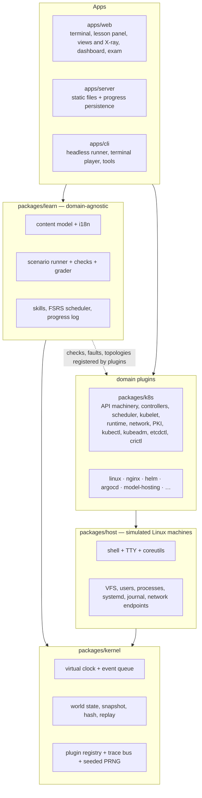

# Simlab — Master Plan

> Baseline approved 2026-11-13. This file is the source of truth for goals, principles, scope and
> architecture decisions. Phase prompts live in `prompts/`, progress in `STATUS.md`, detailed specs in
> `docs/`. "Simlab" is a working name. Change this file deliberately and record why in §15; code must
> not drift from it silently.

## 1. Who this is for and why

I'm a DevOps/infrastructure engineer. I run production RKE2 Kubernetes, Nginx HA, Consul, ArgoCD,
Vault, GitLab CI and Linux servers. Simlab is for me only: single user, local, no auth, no
multi-tenancy.

I want to learn infrastructure topics **by doing**, inside a **simulated** environment: I type real
commands into a terminal, get realistic output, break things, fix them and troubleshoot realistic
failures. There are no real clusters or VMs behind it.

The platform has two jobs of equal weight:

1. **Simulate** a domain faithfully enough that habits and mental models transfer to real systems.
2. **Teach**: make me learn faster and deeper, and move what I learn into long-term memory.

The first domain is Kubernetes (the full CKA and CKAD curricula plus real-world operations). Later
domains (Linux, Nginx, Helm in depth, ArgoCD, AI model hosting, Vault, CI/CD, RKE2 specifics, …) must
plug in without touching the core.

## 2. What success looks like

**Realism**
- Any valid solution path passes a lab. Grading reads final state and behavior, never the commands typed.
- For the supported surface, output matches the real tool byte for byte after normalizing volatile
  fields (ages, UIDs, IPs, timestamps). Each output unit carries a provenance tag (§9).
- Zero silent fakes: input the simulator doesn't support produces a clearly marked simulator notice,
  never an invented "real" error.
- Muscle memory works: tab completion, `alias k=kubectl`, pipes, redirects, heredocs,
  `--dry-run=client -o yaml > f.yaml`, `vim f.yaml`, `kubectl apply -f f.yaml`, `kubectl edit`.
- Timing feels right: Pods take seconds to start, `-w` streams, backoffs back off. A speed control
  removes dead waiting.
- Interactive latency: p95 under 50 ms from Enter to output for read commands.

**Learning**
- Review success rate at the scheduled time stays near the target retention (default 90%).
- Time to solve and hints used trend downward per skill.
- Mock exam scores per curriculum domain are tracked, and every CKA and CKAD competency is covered
  by at least one lesson, several drills, one lab and one troubleshooting item.
- I can open the app, press one button and get today's time-boxed session without deciding what to study.
- Every concept is shown as well as told: each lesson, lab and incident carries at least one figure
  drawn from the simulated world, and the debrief can replay my own attempt (§5, §6.5).

**Extensibility**
- A new domain is added as a plugin package plus a content pack. The kernel, the host substrate and
  the learning layer don't change. This is proven by building a second domain (Linux), not asserted.
- A new domain shows its world through the same view contract (§6.5): the renderer, the figures and
  the replay need no change for it.

## 3. Principles (non-negotiable)

1. **State engine, not a replayer.** The simulator holds a model of the environment. Commands are
   parsed and executed against it: reads render from state, writes mutate it. Simulated controllers
   reconcile it the way the real system does. Recorded data serves presentation fidelity only (exact
   formats and message strings), never behavior.
2. **Honesty over coverage.** Three outcomes exist for any input: it works as the real tool would;
   it fails with the real tool's real error; or it prints a marked `[sim]` notice saying this is not
   simulated, and the gap is logged. A wrong lesson is worse than a missing feature.
3. **Grounded in sources, not memory.** Every user-visible string and format comes from upstream
   source code at the pinned version, official docs, or a captured real output, and says which.
4. **Deterministic.** Same scenario, seed and input log give the same world, always. Time is
   virtual. Every lab runs headlessly in tests.
5. **Learning science is a feature, not decoration.** Retrieval, spacing, interleaving, variation,
   pictures beside words, and feedback are built into the product loop (§5).
6. **Domain-agnostic core.** Kubernetes is the first plugin, not the foundation. Linux hosts are the
   foundation.
7. **Maintainable by one person plus Claude Code.** Simple, well-tested components. Few
   dependencies. No cloud services. Works fully offline once installed.

## 4. Scope

### 4.1 Kubernetes, pinned to v1.37

Both exams are based on Kubernetes v1.37 as of 2026-11-13. The pin is v1.37.2, the latest patch
on that date (`docs/FIDELITY.md` §1). Verified competency lists:

**CKA** — Storage 10% · Troubleshooting 30% · Workloads & Scheduling 15% · Cluster Architecture,
Installation & Configuration 25% · Services & Networking 20%

| Domain | Competencies |
|---|---|
| Storage | storage classes and dynamic provisioning; volume types, access modes, reclaim policies; PVs and PVCs |
| Troubleshooting | clusters and nodes; cluster components; monitoring cluster and application resource usage; container output streams; services and networking |
| Workloads & Scheduling | deployments, rolling updates, rollbacks; ConfigMaps and Secrets; workload autoscaling; self-healing primitives; Pod admission and scheduling (limits, node affinity, …) |
| Cluster Architecture, Installation & Configuration | RBAC; preparing infrastructure; kubeadm clusters; cluster lifecycle; highly available control plane; Helm and Kustomize for cluster components; extension interfaces (CNI, CSI, CRI); CRDs and operators |
| Services & Networking | Pod connectivity; NetworkPolicies; ClusterIP, NodePort, LoadBalancer and endpoints; Gateway API; Ingress controllers and resources; CoreDNS |

**CKAD** — Application Design and Build 20% · Application Deployment 20% · Application
Observability and Maintenance 15% · Application Environment, Configuration and Security 25% ·
Services and Networking 20%

| Domain | Competencies |
|---|---|
| Design and Build | container images (define, build, modify); choosing workload resources; multi-container patterns (sidecar, init); persistent and ephemeral volumes |
| Deployment | blue/green and canary with primitives; rolling updates; Helm for existing packages; Kustomize |
| Observability and Maintenance | API deprecations; probes and health checks; built-in CLI monitoring; container logs; debugging |
| Environment, Configuration and Security | CRDs and operators; authentication, authorization, admission control; requests, limits, quotas; ConfigMaps; resource requirements; Secrets; ServiceAccounts; SecurityContexts and capabilities |
| Services and Networking | NetworkPolicies; access to applications via Services; Ingress rules |

Beyond the exams: real-world incidents, often with chained faults. Pending Pods (taints, quotas, no
StorageClass), Services with no endpoints, NetworkPolicy drops, CoreDNS failures, NotReady nodes
(kubelet down, expired certificates), RBAC Forbidden, rollouts stuck on failing probes, broken
static Pod manifests, etcd restore pitfalls, applications crashing on bad configuration.

Sources: [CKA](https://training.linuxfoundation.org/certification/certified-kubernetes-administrator-cka/),
[CKAD](https://training.linuxfoundation.org/certification/certified-kubernetes-application-developer-ckad/),
[cncf/curriculum](https://github.com/cncf/curriculum), [Kubernetes releases](https://kubernetes.io/releases/).

### 4.2 Later domains

Linux and networking (mostly content on top of the host substrate), Nginx and Nginx HA, Helm in
depth, ArgoCD/GitOps, AI model hosting (GPU nodes, model servers), Vault, CI/CD, Terraform, Kafka,
and an RKE2 flavor of the Kubernetes topology. None is specified in detail yet. `prompts/R4` is the
procedure for adding one.

### 4.3 Non-goals

- No real containers, VMs, kernels or packets. Networking is a reachability model, not a packet simulator.
- No real cryptography. Certificates and keys are structured stand-ins that behave logically.
- No complete bash, vim or kubectl. Each has a documented supported surface and honest notices beyond it.
- No arbitrary container images. Images come from a curated catalog with behavior models.
- No multi-user features, accounts, cloud sync or telemetry.
- No LLM calls at runtime. Claude Code is used outside the app to author content and coach (phase 35).
- No documentation website. Design docs are plain English Markdown.

## 5. Learning design

The simulator is the practice field. The learning layer decides what I practice, when, with how much
help, and what feedback I get. It is domain-agnostic.

**Item types**

| Type | What it is | Typical time |
|---|---|---|
| `lesson` | A short concept with a mental model, then guided steps in the live terminal | 5–10 min |
| `drill` | One skill, one task, done for speed and accuracy. The main vehicle for spaced review | 1–3 min |
| `lab` | A task ticket with a goal and constraints; guidance fades with mastery | 5–15 min |
| `incident` | A vague symptom, as a real ticket would give it; one or several chained faults | 10–30 min |
| `card` | A retrieval question: predict an outcome, explain a cause, recall a fact | under 1 min |
| `exam` | A timed set of weighted tasks with a score report per curriculum domain | 2 h or short |

**Mechanisms**

- **Retrieval over re-reading.** Lessons are short. Most time is spent producing answers in the terminal.
- **Spacing.** Every item is scheduled with FSRS. The rating is derived from performance (passed,
  time against the target, hints used, solution viewed) and I can override it.
- **Variation.** Items are templates with seeded parameters (names, namespaces, images, which fault
  from a family). A review presents a new variant, so I recall the method, not the answer.
- **Interleaving.** The daily queue mixes skills and domains and never shows two items for the same
  skill back to back.
- **Prediction.** Before a key command, an optional prompt asks what will happen. I answer, then see.
- **Faded guidance.** The same skill appears as a worked example, then a completion task, then a
  bare ticket, then inside an incident. Hints form a ladder (nudge, direction, exact command) and
  using them lowers the rating.
- **Show, then tell.** A simulator can show what a real system hides, and a picture next to a
  few words teaches more than the words alone. Tickets, lessons and debriefs carry **figures**. A
  figure is a view of a simulated world (the item's world at the start, the world once solved, my
  world now, or a small scripted run played step by step), rendered by the same code as the live
  view of the system, so it cannot drift from what the simulator does. Prose says what a figure
  cannot; a debrief that is only text is a defect (§6.5, §8).
- **Feedback that explains.** The debrief opens with figures of the cause and the fix. It shows
  which checks passed, the reference solution next to my command history, a replay of my own
  attempt with the causal trace from the engine (why the Pod was Pending, which controller did
  what, what changed when my fix landed), the mental model, and "in reality" notes where the
  simulator or a real distribution differs.
- **Self-explanation and calibration.** I write the root cause in one sentence before the debrief,
  and rate my confidence before checking. Both are stored.
- **Errors feed review.** Failed checks, repeated command errors and hint use are recorded per skill
  and raise the priority of related items.
- **Fluency.** Each drill and lab has a target time, because the exams are time-pressured.

**Model**

- A **skill** is a small unit such as `k8s.scheduling.taints`. Each item lists its skills and the
  curriculum competencies it serves. Mastery per skill is rolled up from item states.
- **Progress** is an append-only event log (attempts, check results, hints, ratings, notes). All
  views are derived from it. It lives in plain files under `data/` so it is easy to back up.
- **The daily session** is a time-boxed queue: due reviews first, then new material from the active
  track.

**Languages.** English is canonical. Vietnamese is optional per text unit, stored in sidecar files
with the hash of the English text it was translated from. The app offers EN, VI or side by side for
prose (lessons, tickets, hints, debriefs). A missing or outdated translation shows the English text
with a badge; it never blocks anything. Terminal output is always the real tool's English. Technical
terms, resource names, commands, flags and code stay in English inside Vietnamese text.

## 6. Architecture



Dependency rule, enforced by lint: `kernel` ← `host` ← domain plugins. `learn` depends on `kernel`
and on no domain. Apps wire everything together. The engine packages use no DOM and no Node APIs, so
the same code runs in a browser Web Worker and in Node for tests.

### 6.1 Kernel

- **World state is plain data.** One JSON-serializable tree holds everything: machines, domain
  state, clock, PRNG state, pending events. Behavior lives in code and state lives in data. That
  makes snapshot, restore, fork, diff and hashing trivial.
- **Virtual time, discrete events.** A clock and a priority queue ordered by (time, sequence).
  Pending events are data (`type` + payload) dispatched to handlers registered by type, never
  closures, so they survive a snapshot.
- **Time drivers.** Interactive: virtual time follows wall-clock time at a chosen speed, with
  "skip to next event". Headless: time advances only on request (`advance`, `settle`).
- **Seeded PRNG** with named streams, so a new random draw in one subsystem doesn't perturb another.
- **Input log and replay.** A session is scenario id, seed, and a log of inputs stamped with virtual
  time (terminal bytes, editor saves, UI actions). Resuming a session, the replay view in the debrief
  and bug reports all use replay. Snapshots are taken only when no foreground program is mid-flight;
  they serve scenario setup, checks and checkpoints.
- **Fork for checks.** Checks run against a fork of the world, so grading never disturbs my session.
- **Trace bus.** Components emit structured cause records ("scheduler rejected node01: untolerated
  taint"). The X-ray view, figures, the debrief and tests consume them.
- **Plugin registry.** A plugin registers programs, state slices, actors and event handlers,
  topology templates, check functions, fault injectors, completions and view providers (§6.5).

### 6.2 Host substrate

A **machine** is a simulated Linux host: hostname, VFS (modes, owners, symlinks, generated files),
users, environment, process table, systemd units and journal, packages, network addresses and
listening sockets. Exam nodes, the student workstation and (with a restricted view) containers are
all machines.

- **Executables are VFS files** that point at a registered program. `which`, `PATH`, a missing
  binary and a wrong `ExecStart` path therefore behave naturally.
- **Shell.** A bash subset with a real lexer, parser and executor: quoting, variables, `$?`,
  command substitution, pipes, redirects, heredocs, `&&`, `||`, `;`, globbing, aliases, and later
  `if`/`for`/`while`. The supported surface is documented; anything else gets a `[sim]` notice.
- **TTY.** Line editing, history, Ctrl-C, Ctrl-R and tab completion are part of the engine and
  tested headlessly. The UI only moves bytes.
- **Programs** receive argv, environment, cwd, streams and machine access. They can block in virtual
  time (`sleep`, `kubectl get -w`, `rollout status`) and be interrupted.
- **Editor.** `vim`, `vi`, `nano` and `kubectl edit` open an editor overlay in the UI (CodeMirror
  with Vim keybindings). Headless runs supply the edited content directly. A terminal-native vi is
  out of scope.
- **Units and processes.** systemd units are state machines whose processes are behavior models
  (§6.3). `systemctl`, `journalctl`, `ps` and `ss` render from that state.

### 6.3 Behavior models

Nothing really executes, so anything that "runs" (a container image, kubelet, nginx, etcd) is a
**behavior model**: given its resolved configuration (command, args, environment, mounted files,
network view), it declares its lifecycle (runs, exits with a code after a time, crashes with a log
line), listening ports, responses, log output, resource usage and dependencies. Models are small,
declarative where possible, and curated in a catalog. This is what makes real-world incidents
possible ("the app crash-loops because `DB_HOST` is wrong") and what later domains reuse.

### 6.4 Adding a domain

A domain is one plugin package plus one content pack: state slice, behavior models, programs,
checks, faults, topology templates, a view provider, and content. `docs/ADDING_A_DOMAIN.md`
(phase 34) holds the checklist, written from the experience of adding Linux.

### 6.5 Views

The visual layer is one mechanism with several surfaces, and it knows no domain.

- **View provider.** A plugin turns a world into a **view model**: entities (stable id, kind,
  label, what contains them, state, a few facts), typed relations between them (owns, runs on,
  selects, routes to, mounts), and, from the trace, what happened and why. It is a pure function
  of world state, so it works on the live world, on a fork, and on a world rebuilt by replay. Each
  domain describes its kinds with a small fixed vocabulary of shapes the renderer knows; the
  renderer, `learn` and the apps never name a Pod or a systemd unit.
- **Renderer.** One renderer draws every view model: containment (machines hold processes, nodes
  hold Pods), relations as links, state as styling, change as motion. Something moves only when
  the world changed or the trace recorded a cause.
- **Surfaces.** (1) **X-ray**: the live view of the world beside the terminal. It is help: using
  it is recorded and lowers the rating, and exam mode turns it off. (2) **Figures** in tickets,
  lessons and debriefs (§8): a view of a named world, two views compared, a hand-drawn concept
  diagram in the same vocabulary, or a **scene**, a scripted run the engine really executes and I
  step through. (3) **Replay**: the debrief plays my attempt from its input log, with the causes.
- **Honesty.** Views follow principles 1 to 3. A view shows what the model holds and nothing else:
  no decorative traffic, no internals the engine does not simulate. Where the model is coarser
  than reality (reachability, not packets), the figure says so and links the divergence register.
  A hand-drawn diagram is prose in another form and is held to the same sources as prose.
- **The look.** The app's design language (type, spacing, depth, motion, the colors of states) is
  defined once in `docs/DESIGN.md` and shared by the interface and the views.

## 7. Kubernetes plugin design

- **API machinery.** A resource registry (group, version, kind, scope, short names, verbs) covering
  built-ins and CRDs. An object store with `resourceVersion` and watch; this is the etcd content. A
  request pipeline: identity from kubeconfig, RBAC authorization, defaulting and mutating admission,
  schema validation, validating admission (quota, LimitRange, Pod Security, immutability), persist,
  notify watchers.
- **Schema from upstream.** The OpenAPI v3 documents of the pinned version are processed and
  vendored. They drive `kubectl explain`, unknown-field and type errors, and CRD validation.
  Defaulting and semantic validation are ported by hand per kind from upstream, most common mistakes first.
- **Controllers** are reconcilers fed by watch events through work queues, processed in a
  deterministic order with modeled latency: Deployment, ReplicaSet, StatefulSet, DaemonSet, Job,
  CronJob, EndpointSlice, garbage collector, namespace, ServiceAccount, node lifecycle, PV binder and
  provisioner, HPA, ResourceQuota, CSR approval, Ingress and Gateway controllers.
- **Scheduler.** Filter plugins (node name, unschedulable, taints, selector and affinity, resource
  fit, inter-Pod affinity, topology spread, volume binding, ports), deterministic scoring, and
  `FailedScheduling` messages in the real format.
- **Kubelet and runtime per node.** The kubelet drives the Pod lifecycle through the simulated
  container runtime: sandbox, image pull, init and sidecar containers, start, probes, restarts with
  backoff, termination, volumes, environment resolution, QoS, OOM, status, conditions and events. Logs
  are written into the node VFS, so `kubectl logs`, `crictl logs` and `/var/log/pods` agree.
- **Components are processes on nodes.** The kubelet is a systemd unit on its machine. The API
  server, etcd, scheduler and controller manager are static Pods from `/etc/kubernetes/manifests`.
  Their flags are parsed and matter. If the API server isn't running, `kubectl` gets the real
  connection error. If the scheduler is down, Pods stay Pending. If etcd points at another data
  directory, the cluster has other content. This coupling is the core of CKA troubleshooting and must
  be real, not scripted.
- **PKI model.** Certificates are structured objects in PEM-shaped files with subject, issuer, SANs
  and validity checked against the virtual clock. `openssl x509`, `kubeadm certs`, kubeconfig
  credentials and CSR approval work on them. Advancing the clock can expire a cluster.
- **Network model.** `connect(source, destination, port)` resolves DNS (CoreDNS health and
  configuration, search domains), Service routing (kube-proxy health, endpoints), NetworkPolicy
  (if the CNI enforces it), Ingress and Gateway routes, then the target's listeners. It returns what
  the real client would see: resolved and answered, could not resolve, refused, or timed out. Probes,
  `curl`, `wget`, `nc`, `nslookup` and checks all use it.
- **Programs.** `kubectl`, `kubeadm`, `etcdctl`, `etcdutl`, `crictl`, `helm`, `kustomize`,
  `docker`/`podman` (image build).
- **Topology templates.** `kubeadm-1cp-2w` (controlplane, node01, node02 plus a student
  workstation) is the default. Others: single node, a bare set of machines for `kubeadm init`, an HA
  control plane.

## 8. Content model

Content lives in packs under `packages/content/<pack>/`. Structure is YAML, prose is Markdown inside
it, and everything is validated against a schema at build time. A scenario declares the world, not a
transcript:

```yaml
id: k8s.sched.pending-taint-01
kind: lab
title: Pods stuck in Pending after a node change
skills: [k8s.scheduling.taints, k8s.troubleshooting.pending-pods]
curriculum: [cka.troubleshooting.clusters-nodes, cka.workloads.pod-scheduling]
difficulty: 2
targetMinutes: 6
world:
  topology: kubeadm-1cp-2w
  params:                      # seeded variation
    ns:  { pick: [shop, billing, media] }
    key: { pick: [maintenance, dedicated, gpu] }
  setup:                       # declarative objects, sim commands, fault injectors, time
    - apply: |
        apiVersion: apps/v1
        kind: Deployment
        metadata: { name: web, namespace: "{{ns}}" }
        # …
    - run: kubectl taint nodes node01 node02 {{key}}=true:NoSchedule
    - advance: 90s
ticket: |
  The `web` Deployment in namespace `{{ns}}` has no running Pods. Make all 3 replicas run.
  Do not remove taints from the nodes.
hints:
  - Look at why the scheduler rejected each node.
  - Compare the node taints with the Pod's tolerations.
  - "`kubectl describe pod` shows the FailedScheduling event; add a matching toleration to the Deployment."
checks:
  - id: replicas-ready
    title: All replicas of `web` are ready
    assert: k8s.podsReady
    with: { namespace: "{{ns}}", selector: app=web, count: 3 }
  - id: taints-kept
    title: The taints are still on the nodes
    assert: k8s.nodeHasTaint
    with: { nodes: [node01, node02], key: "{{key}}" }
solutions:                     # each runs headlessly in tests and must pass every check
  - - run: kubectl -n {{ns}} patch deploy web --type=json -p '[…]'
    - advance: 30s
debrief: |
  Root cause, the mental model, the reference solution explained, and "in reality" notes.
```

Figures are blocks inside the ticket, a lesson step or the debrief (the format is specified in
`docs/SCENARIO_FORMAT.md` by phase 10c):

```yaml
debrief:
  - figure:
      kind: compare                # view | compare | scene | diagram
      left:  { of: start }         # the world after setup
      right: { of: solved }        # the world after the reference solution
      focus: { scope: "{{ns}}", kinds: [Deployment, ReplicaSet, Pod, Node] }
      show: [Taints, Tolerations]
      caption: The taint kept every Pod off `{{ssdNode}}` until the Pod template tolerated it.
      alt: Left, at the start, …; right, solved, …
  - text: |
      What the figure cannot say: a toleration permits, it never attracts.
```

A ticket's figure shows only what the ticket states, the way a real ticket might attach a sketch
of the setup; it never shows the cause. Exam tasks carry no figures.

Rules that tests enforce for every item and several seeds: the schema is valid; the checks **fail**
on the untouched world; every reference solution **passes**; hints and debrief exist; every figure
resolves (its focus selects something, its scene runs without a gap). Vietnamese
text lives in `<id>.vi.yaml` next to the item. Phase 00 writes the full format specification with
three worked examples (a CKAD workload task, a CKA node troubleshooting task, a chained incident).

Checks are functions registered by plugins (`k8s.*`, `host.*`, `net.reach`) plus a generic
`shell.exec` that runs a command in the forked world and asserts on its exit code or output.

## 9. Fidelity and honesty

- **Version pin.** One constant holds the Kubernetes version. Upstream-derived data is stored per
  version. `prompts/R5` is the bump procedure.
- **Upstream reference checkout.** `npm run upstream:fetch` sparse-clones the needed parts of
  `kubernetes/kubernetes` at the pinned tag into `.upstream/` (git-ignored). Table columns come from
  the printers, `describe` layouts from kubectl's describers, event and error strings from the
  component that emits them. Code that reproduces a format cites the upstream path.
- **Provenance tags.** Every output unit (a table printer, a describer, an error family) is
  registered as `source-derived`, `golden-verified` or `approximate`. `npm run fidelity:report`
  prints the table.
- **Simulator notices and the gap log.** Unsupported commands, flags and resources print
  `[sim] … is not simulated yet` in a distinct style and append to `data/gaps.jsonl`.
  `prompts/R3` turns the gap log and my feedback into fixes.
- **Real binaries as a development oracle.** The official release binaries of the pinned version
  (`kube-apiserver`, `etcd`, `kube-controller-manager`, `kube-scheduler`, `kubectl`, `kubeadm`) run
  on my workstation without Docker. A tool starts them as a throwaway control plane with fake nodes,
  runs declarative cases and stores normalized output as **golden fixtures**. A differential test
  runs the same cases in the simulator and diffs. This verifies everything the API server,
  controllers, scheduler and kubectl produce. Client-only output (help text, generators,
  `kubectl kustomize`, `helm template`) comes from the real binaries with no server at all. For shell
  tools and systemd, the workstation's own bash, coreutils and systemd are the reference.
- **Tier 2 fixtures (optional).** What only a real kubelet and node can show (Pod lifecycle events,
  kubelet logs, `crictl`) needs a full cluster: a capture script for kind, run on any machine with
  Docker, since my workstation has none. Until then those units stay `source-derived`.
- The oracle and fixtures are development tools. The platform never needs them at runtime, and the
  quality gate never needs the network.
- **Divergence register.** `docs/FIDELITY.md` lists where the simulator knowingly differs from
  reality. Debriefs link to relevant entries.
- **Views are output too.** A view is rendered from world state and the trace, so it cannot show
  something the terminal would contradict; a test compares the two. Words a view prints that a
  real tool also prints (a status, an event reason) come from the same sources as the tool's
  output.
- **Update check.** A tool compares the pin with upstream releases and the recorded curricula with
  the current official ones, and writes a report of needed changes. It can run on a schedule.

## 10. User experience

A local web app, started with one command.

- **Workspace.** Terminal tabs (xterm.js), a panel for the lesson or ticket with its figures and
  check, hint and reset actions, its parts (ticket, check, hints, debrief, solutions) in tabs
  from phase 10d, and an optional X-ray view of the world (machines, nodes, Pods, Services,
  health, the causal trace), docked beside the terminal or floating over the workspace, that exam
  mode turns off. A speed control and "skip to next event".
- **Home.** Today's session, mastery by skill and curriculum domain, due counts, recent mistakes,
  and a content browser for free practice.
- **Debrief.** As described in §5: figures first, then the replay of my attempt, then prose.
- **Look.** One design language (`docs/DESIGN.md`) for the interface and the views: a clear type
  scale and spacing rhythm, depth that separates the areas of the workspace, motion only where
  something changed. The system on screen is what gives the product its character.
- **Exam mode.** Timer, task list with flags and weights, no hints, no X-ray, score report per
  domain; results feed the scheduler.
- **Terminal player.** `npm run play` puts me in a simulated machine from my real terminal, and
  `npm run lab -- <id>` plays any item there. It is a development tool and an early way to judge feel.

A TUI was considered as the main interface and rejected: the visualization, the bilingual lesson
panel, the dashboard and the editor overlay are all easier and better in a browser, and the engine
stays UI-independent either way.

## 11. Technology

| Area | Choice | Why, and what was rejected |
|---|---|---|
| Language | TypeScript, strict | One language for engine, UI and tools; the engine runs in the browser with no round trips. Go or Python engines would need a server hop per keystroke or WebAssembly, and split the codebase. |
| Runtime | Node 24 or later (the workstation runs Node 26), npm workspaces | Already installed; no extra tooling. |
| Tests | Vitest, plus Playwright for a few UI smoke tests | Fast, TypeScript-native. |
| UI | Vite, React, xterm.js, CodeMirror 6 with Vim keys | Mainstream, well documented. All assets bundled; nothing loads from a CDN. |
| Engine hosting | Web Worker | Keeps the UI responsive; the same engine API is called directly in Node. |
| Persistence | Small local Node server writing append-only JSONL under `data/` | Browser storage alone is too easy to lose; plain files are transparent and easy to back up. A database is unnecessary at this size. |
| Content | YAML and Markdown, validated with a schema library | Readable diffs, easy authoring by hand or by Claude Code. |
| Scheduling | FSRS through a maintained library | Proven algorithm; no reason to hand-roll it. |

**Why not a real control plane?** Real API server with fake nodes (KWOK), or kind, gives perfect
kubectl output. It was rejected as the base because it can't cover node-level work (kubelet,
static Pods, etcd restore, kubeadm upgrade, certificates), isn't deterministic or instantly
resettable, can't travel in time, can't show causes, can't run in a browser, and doesn't extend to domains
where real infrastructure is costly (HA pairs, GPU nodes). The cost of this choice is reimplementing
a large kubectl and API surface. The real control plane is used instead as a development oracle
(§9), which is how that cost is kept honest.

## 12. Quality gates

- `npm run check` is the single gate: type check, lint (import boundaries, determinism bans on
  `Date`, `Math.random` and timers in engine packages), unit tests, content validation.
- **Transcript tests** are the main specification for commands: readable files with a world setup,
  commands and expected output using normalization tokens.
- **Simulation tests** drive controllers in virtual time and assert on state and trace.
- **Determinism tests**: the same seed and input log give the same world hash; snapshot, restore
  and continue equals continue.
- **Content tests** as in §8.
- **No feature without a test and a consumer.** An engine feature lands with transcript or
  simulation tests and at least one content item that uses it.

## 13. Roadmap

One phase is one Claude Code session. Prompts are in `prompts/`; `STATUS.md` lists them in the
order to run and tracks progress. Numbers group topics; a letter suffix means a topic was split to
fit a session. If a phase still proves too large, the session stops at a clean boundary and records
the remainder in `STATUS.md`; rerun the same prompt.

**M0 — Foundations**
- 00 Bootstrap, version pin, architecture and scenario format specs

**M1 — Thin vertical slice** (judge whether it feels real before building breadth)
- 01 Kernel and VFS
- 02 Shell and first coreutils
- 03 TTY, completion, terminal player
- 04 Real control plane as an oracle, golden fixtures
- 05a API schema, store, request pipeline · 05b Controller runtime and first controllers
- 06a Topology and scheduler · 06b Kubelet, container runtime, behavior models
- 07a kubectl framework, get, output formats · 07b describe, create, apply, delete
- 08 kubectl imperative verbs, logs, rollout, explain, edit, completion
- 09 Scenario runner, checks, grader, three labs
- 10 Web app: terminal, lab panel, editor overlay

**Checkpoint A.** I play the three labs and write `FEEDBACK.md`. Exit: the criteria of §2
"Realism" hold for the slice, and I decide to continue. Then run `prompts/R3`. (Done 2026-11-17:
the terminal feels real; the product is all text and looks bland. Hence 10b and 10c.)

- 10b Visual foundation: design language, view model, renderer, live X-ray
- 10c Figures in content: views, comparisons, diagrams, scenes; the three labs retrofitted

**Checkpoint A2.** I play the three labs again with the X-ray and the figures. Exit: the labs show
the system as well as describe it, and I'd rather use this than a text-only lab. Then run
`prompts/R3` if `FEEDBACK.md` has entries. (Done 2026-11-17: no complaint about the figures or
the X-ray's content; the interface around them looks dated and the lab panel is one long scroll.
Hence 10d.)

- 10d Interface refresh: a modern look chosen from screenshots, the lab panel in tabs, a floating X-ray

**M2 — Learning loop**
- 11 Learning core: content model, i18n, progress log, skills, FSRS, daily queue, local server
- 12 Learning UI: home, item flows, hints, prediction, debrief, language toggle
- 13 Causal trace, replay of my attempt, time controls
- 14 Curriculum map, skill graph, authoring guide, content tooling
- R1 run for `k8s-foundations`

**Checkpoint B.** I use the daily session for a week. Exit: the loop works end to end and I'd keep
using it. Then run `prompts/R3`.

**M3 — Application-level Kubernetes** (CKAD and the API-level part of CKA)
- 15 kubectl output shaping, selectors, patch, replace, wait, diff, config
- 16a Pod configuration, volumes, multi-container · 16b Probes, resources, security context
- 17 Exec and the network model: container shell, DNS, Services, client tools
- 18a Job, CronJob, DaemonSet, StatefulSet · 18b Strategies, metrics, autoscaling
- 19a Service types, NetworkPolicy · 19b Ingress, Gateway API (after 20c)
- 20a Identity and RBAC · 20b Admission, quotas, Pod Security, scheduling policy · 20c CRDs, operators, deprecations
- 21 Storage
- 22a Shell control flow, sed, find, xargs · 22b awk, jq, pager (both can run any time after 03)
- 23 Kustomize and image builds
- 24 Helm

**M4 — Node-level Kubernetes** (CKA)
- 25a systemd, journal, processes, users, SSH · 25b Packages, system configuration, PKI
- 26a Kubelet and runtime as node services, static Pods, node lifecycle · 26b crictl, node operations, node incidents
- 27 Control plane as static Pods, failure modes, certificate expiry
- 28 etcd backup and restore, kubeadm certificates
- 29a kubeadm prepare, init, join · 29b Upgrade · 29c HA control plane
- 30 Cluster networking troubleshooting: CoreDNS, kube-proxy, CNI

**M5 — Exams, fidelity, extensibility**
- 31 Exam mode
- 32 Tier 2 golden fixtures and fidelity audit (optional)
- 33 Update check and version bump tooling
- 34 Linux pack and the adding-a-domain guide (any time after 25b)
- 35 Coach skills for Claude Code

**Repeatable prompts**
- R1 Content pack for one area (fourteen targets for Kubernetes)
- R2 Vietnamese translation pass
- R3 Feedback and gap triage
- R4 New domain (spec, engine, content)
- R5 Kubernetes version bump

Engine phases from 15 onward each ship a few items that exercise the new features, extend their
domain's view provider for what they add, and give those items figures. R1 runs fill the
curriculum: interleave them with engine phases as soon as the features a target needs exist, so
there is always fresh material to learn from while the platform grows.

## 14. Risks and honest limits

| Risk | Mitigation |
|---|---|
| **Negative transfer**: the simulator teaches something false. The worst failure for a learning tool. | Source grounding, provenance tags, `[sim]` notices, golden diffs, the divergence register, "in reality" notes in debriefs. |
| **Scope explosion** across kubectl, bash and Kubernetes behavior. | Vertical slices, a coverage matrix, the gap log deciding priorities, "no feature without a consumer". |
| **Shell fidelity.** Bash is endless. | A documented subset built on a real parser; notices beyond it. |
| **Editor fidelity.** Not real vim. | CodeMirror Vim mode covers everyday editing; stated as a divergence. |
| **Behavior models are curated.** Unknown images don't exist in the simulated registry. | A catalog of common images; scenarios declare extra ones; pulling an unknown image fails the way a missing image does, and the gap is logged. |
| **Network realism.** No packets, no iptables rules, no tcpdump. | The reachability model returns client-visible outcomes; packet-level tools are non-goals. |
| **Content volume and quality.** Hundreds of items. | An authoring guide, strict automated validation, variants, R1 runs per domain, my review at checkpoints. |
| **Walls of text.** Content that reads like every other lab, and that I stop reading. | Figures are part of the format and required by the authoring rules; prose says only what a figure cannot; the replay shows my own attempt (§5, §6.5). |
| **A picture that lies.** A diagram drifts from what the simulator does, or implies detail the model lacks. | Views are rendered from world state by one renderer and validated per seed; motion only for recorded causes; coarse models say so (§6.5, §9). |
| **Curriculum and version drift.** The exams follow new releases within weeks. | A single version pin, per-version data, the update check, R5. |
| **Context overflow in a build session.** | Phases sized for one session, a carry-over protocol, subagents for bulky reading. |
| **Unverified kubelet and node output.** The local oracle has no real kubelet. | Upstream source for those strings; tier 2 capture (phase 32) whenever a machine with Docker is available. |

## 15. Decision record

- **2026-11-13** Baseline. Reworked from the original planning prompt (`archive/plan-prompt.original.md`):
  - Added the learning layer as a first-class half of the product (§5). The original covered
    simulation and progress tracking but had no mechanism for retention.
  - Made simulated Linux hosts the foundation and Kubernetes a plugin (§6), because CKA node work,
    container exec and every later domain need the same substrate.
  - Vietnamese applies to learning content only, in-app. Design docs are English Markdown and the
    custom documentation site is dropped. (My decision when asked.)
  - Replaced the single planning session producing nine documents with this plan, two specs written
    in phase 00, and living docs updated by the phase that builds each subsystem.
  - Added the honesty rule (`[sim]` notices, gap log, provenance tags) and replay-based sessions.
  - Chose TypeScript with the engine in the browser; pinned Kubernetes v1.37 after checking the
    official exam pages.
  - Made golden fixtures a core development practice instead of an optional extra: the real
    release binaries run locally without Docker and serve as an oracle from phase 04 on. kind-based
    capture remains optional (tier 2).
- **2026-11-13** Phase 00, both confirmed by me (`docs/decisions.md` D-001, D-002):
  - The pin is v1.37.2. 1.37.1 was the latest patch when the baseline was written; 1.37.2 was
    released since.
  - A check is written as `assert: <name>` plus `with: { … }`. The one-line form in the §8
    example was not valid YAML.
- **2026-11-15** Work moved to a new workstation after phase 00, at my request
  (`docs/decisions.md` D-017):
  - It runs Pop!_OS 24.04, an Ubuntu 24.04 derivative, with Node 26. §11 now says Node 24 or later;
    `package.json` already required `>=24` and the gate passes on 26.
  - The workstation's own tools (§9) are now bash 5.2, GNU coreutils 9.4 and systemd 255. Their
    versions and how to capture from them are in `docs/FIDELITY.md` §2.1. It still has no Docker,
    so tier 2 stays optional as written.
- **2026-11-17** After Checkpoint A (`docs/feedback-log.md`), decided by me when asked:
  - The visual layer comes next, before the learning loop: phases 10b and 10c, then Checkpoint A2
    (§13). My verdict on the slice was that the terminal feels real, but the content is a wall of
    text, the debrief has no visual presentation, the interface looks bland (dull type and
    spacing, flat, and nothing shows the system), and a dynamic picture of the system would teach
    better, for Kubernetes and for the later domains alike.
  - Views became a first-class mechanism (§5 "Show, then tell", §6.5, §8 figures, §9, §10).
    Before, the plan had one visual surface, the X-ray panel of phase 13, optional and counted as
    help. Now one view contract and one renderer serve the X-ray, figures in content, and the
    replay of my attempt in the debrief. A domain's view provider is required, not optional (§6.4).
  - Phase 13 keeps what needs the learning loop: the trace audit, the "Why?" inspector, the
    timeline, the replay, time controls and assist levels. Its view contract and panel moved to 10b.
  - A text-only debrief is a defect from 10c on (§5); phases 12, 14, R1, R4 and 34 were revised
    to build on figures.
- **2026-11-17** After Checkpoint A2 (`docs/feedback-log.md`), decided by me when asked:
  - Phase 10d comes next, before the learning loop (§13): the look is reopened, the lab panel's
    parts become tabs, and the X-ray can float over the workspace inside the page (§10). My
    verdict: the interface "feels like old Bootstrap websites". Asked what modern means, I chose
    floating rounded panes, fewer lines and more air, more color and depth, and to be shown
    options. In 10b I chose Instrument over Studio from two directions; 10d shows new ones as
    screenshots and I choose again. Phase 12 builds its screens on the result, which is why 10d
    is not folded into it.
  - The floating X-ray is a panel in the page, not a separate browser window.
