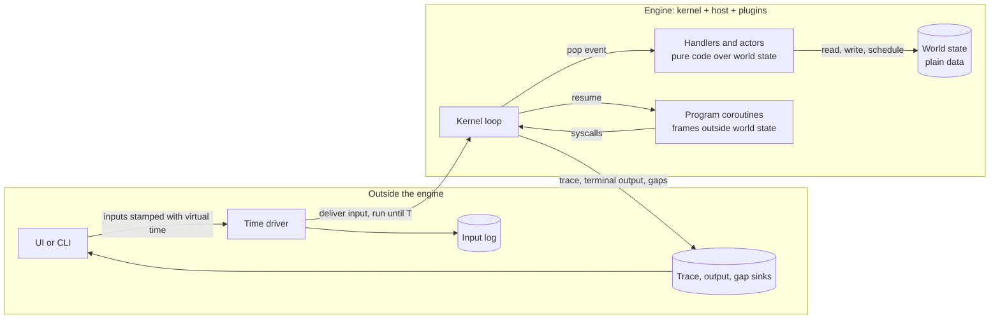
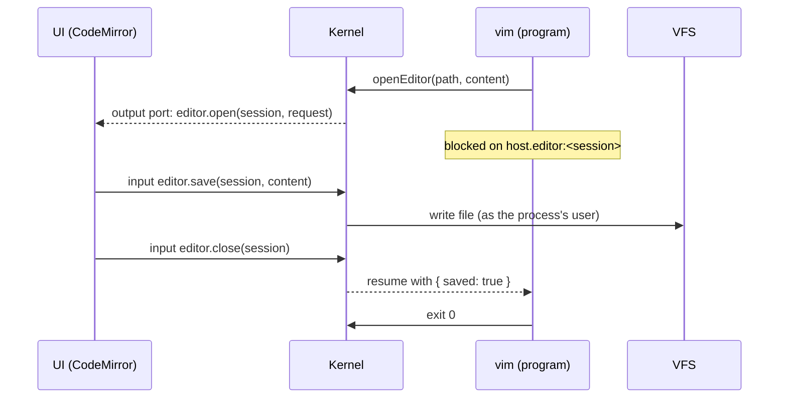
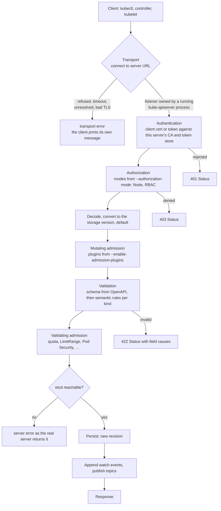
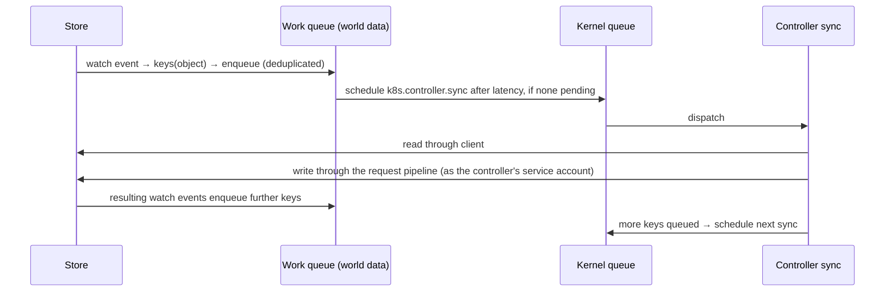
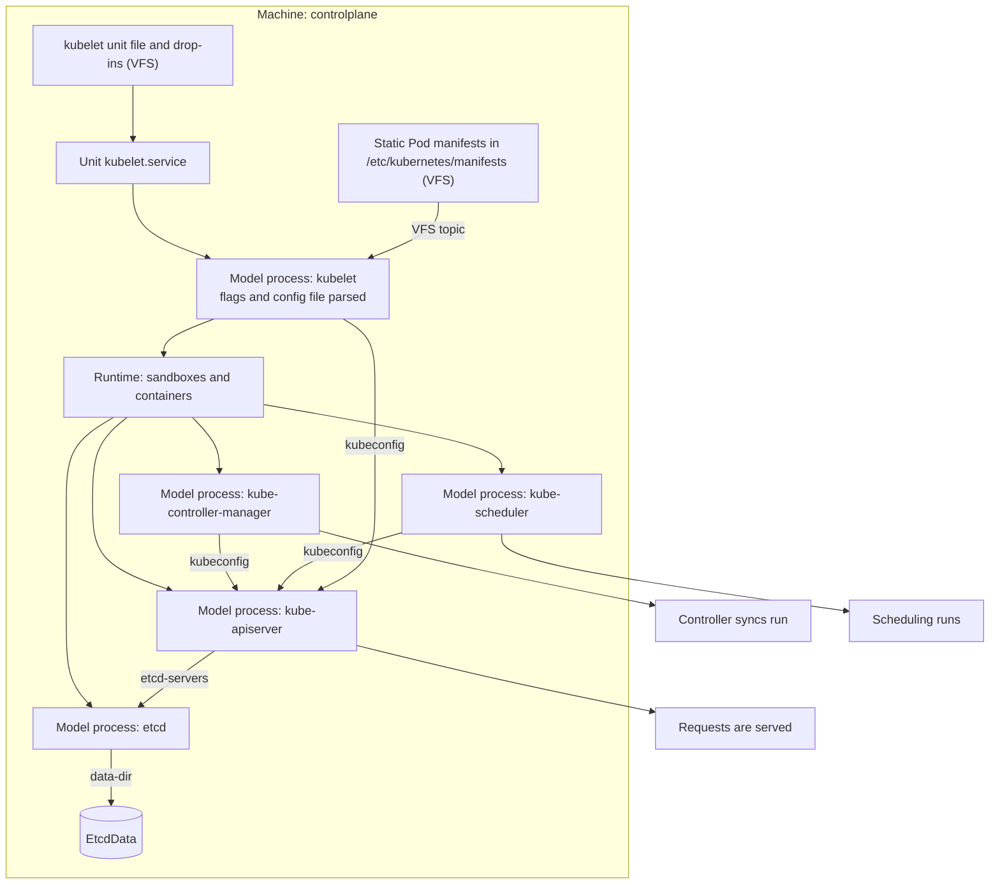

# Architecture

The contract that phases 01 onward implement. `PLAN.md` §6 and §7 decide what exists; this
document decides how the pieces fit: the data shapes, the interfaces between packages and the
rules that keep the engine deterministic. Interface sketches are TypeScript and are normative in
structure, not in every field name: a phase may add fields, and records the change here.

Reading order: §1 gives the model in one page, §2 to §4 specify the kernel, the host substrate and
the Kubernetes plugin, §5 answers the hard questions in one place, §6 lists what each phase still
has to decide.

## 1. The model in one page



- **World state** is one tree of plain data. Everything the simulated environment *is* lives
  there: machines, files, processes, Kubernetes objects, the clock, PRNG state, pending events.
- **Behavior is code outside the world**, registered by plugins: event handlers, actors
  (controllers, kubelets, units), programs (`ls`, `kubectl`), checks, faults.
- **Time is virtual.** The kernel pops the earliest pending event, sets the clock to its time and
  dispatches it. Nothing in the engine reads a real clock or sets a real timer.
- **The only way in is an input**: terminal bytes, an editor result, a UI action, each stamped
  with the virtual time at which it is delivered. The same scenario, seed and input log produce
  the same world, the same output and the same trace.
- **Two kinds of running things.** *Actors* are long-lived simulated components; their whole state
  is world data and they advance by handling events, so they survive fork and snapshot. *Programs*
  are what a shell runs; each is a synchronous generator whose frame lives outside world state and
  which the kernel resumes at deterministic points.

Package boundaries (enforced by `simlab/package-boundaries`, table in `tools/eslint/boundaries.js`):

| Package | May import | Holds |
|---|---|---|
| `kernel` | nothing | world, clock, queue, PRNG, fork, hash, replay, trace, registry, extension contracts |
| `host` | `kernel` | machines, VFS, processes, streams, TTY, shell, coreutils, systemd, network endpoints |
| `k8s` (and later domains) | `kernel`, `host` | domain state slice, actors, programs, checks, faults, topologies |
| `learn` | `kernel` | content model, scenario runner, grader, skills, scheduler, progress log |
| `content` | `kernel`, `learn` | packs as data |
| apps, tools | any package | wiring, real I/O, time drivers |

`learn` never imports a domain. It reaches checks, faults, setup steps and topologies through the
kernel registry, whose contracts (§2.11) are defined in `kernel` for exactly that reason.

## 2. Kernel

### 2.1 World state

```ts
type Json = null | boolean | number | string | Json[] | { [key: string]: Json };

interface World {
  /** Layout version of the kernel part; slices carry their own. */
  schema: number;
  seed: number;
  clock: Clock;
  /** Binary min-heap ordered by (at, seq), stored as an array. Cancelling removes the entry. */
  queue: PendingEvent[];
  /** One state per named PRNG stream, created on first use and advanced in place. */
  prng: Record<string, PrngState>;
  /** Counters for deterministic ids (pids, inode numbers, input numbers, waiter ids). */
  counters: Record<string, number>;
  /** Wake topics with their waiting subscribers (§2.4). A table: entries are frozen. */
  topics: Table<TopicState>;
  /** One slice per plugin, keyed by plugin name: `host`, `k8s`, … */
  slices: Record<string, unknown>;
}
```

Phase 01 implemented this in `packages/kernel/src/world.ts`. It dropped the planned `cancelled`
map: `cancel` finds the event in the heap and removes it (O(n) to find, O(log n) to fix), which
keeps the world free of tombstones.

Rules for everything reachable from `World` (CLAUDE.md hard rule 5):

- Only JSON types. No class instances, functions, `Map`, `Set`, `Date`, `undefined` values,
  `NaN`, typed arrays or cycles. References between things are ids (strings), never pointers.
- Every node is either a **container** or a **value**:
  - A *container* is mutable and belongs to exactly one world: the root, a slice, a table.
  - A *value* is deeply frozen and may be shared between worlds: a Kubernetes object, an inode, a
    process record, a pending event.
  - A **table** is a container `Record<string, V>` whose entries are values. Changing an entry
    means storing a new frozen value under the key; values are never edited in place.
- The frozen flag is the marker. `Object.isFrozen(node)` means value. The kernel's `put` helper
  deep-freezes what it stores. Editing a value in place throws a `TypeError` (modules are strict
  mode), so a violation is loud.

```ts
type Table<V> = Record<string, V>;

/** Deep-freezes `value` and stores it. The only way entries enter a table. */
function put<V>(table: Table<V>, key: string, value: V): V;
function remove<V>(table: Table<V>, key: string): void;
/** Keys in code-unit order. Iteration that affects behavior uses this, never `for…in`. */
function keys<V>(table: Table<V>): string[];
```

Iteration order: JavaScript iterates integer-like keys first and the rest in insertion order.
That order is deterministic but an accident of history, so code whose result depends on order
iterates `keys(table)` (sorted) or an explicit order field. This is the "defined order" of
CLAUDE.md hard rule 4.

A **slice** is declared by its plugin:

```ts
interface SliceSpec<S> {
  /** Plugin name; the key under `world.slices`. */
  name: string;
  /** Bumped when the slice layout changes. A snapshot with another version is refused. */
  version: number;
  init(seed: number): S;
  /** After deserialization: freeze the values so later forks share them (§2.7). */
  adopt(slice: S): void;
}
```

### 2.2 Clock

```ts
/** Milliseconds, an integer. */
type Millis = number;

interface Clock {
  /** Virtual wall-clock time in ms since the Unix epoch. */
  now: Millis;
  /** Value of `now` when the world was created; `now - start` is the uptime. */
  start: Millis;
  /** Sequence number for the next scheduled event. */
  seq: number;
}
```

- `clock.start` comes from the session header (§2.8). An interactive session uses the real time at
  which it began, read once by the app and recorded; headless runs use the scenario's
  `world.startTime` or a fixed default. Either way the engine receives it as data.
- Dates are rendered by pure functions in the kernel (`formatRfc3339(ms)`, civil-date arithmetic).
  The `Date` object is banned in engine packages. Simulated machines run in UTC.

### 2.3 Events

```ts
interface PendingEvent {
  /** Unique within the world: the `seq` it was scheduled with, as a string. */
  id: string;
  at: Millis;
  seq: number;
  /** Dotted, prefixed by the plugin that handles it: `host.proc.run`, `k8s.controller.sync`. */
  type: string;
  payload: Json;
  /** Id of the event or input being handled when this one was scheduled (causal chain, §2.9). */
  cause?: string;
}

interface HandlerSpec {
  type: string;
  /** Periodic background work (heartbeats, resyncs). See `settle` in §2.5. */
  idle?: boolean;
  handle(ctx: Ctx, payload: Json): void;
}
```

- Order is `(at, seq)`. `seq` is assigned when the event is scheduled, so events for the same
  instant run in the order they were scheduled. There is no other tie-break.
- An event is data. It names its handler by `type`; a handler is found in the registry. A closure
  can never be scheduled.
- A handler runs to completion and synchronously. It may read and write the world, schedule and
  cancel events, draw from PRNG streams, publish to topics and emit trace records.
- An event whose type has no registered handler is an engine bug: the kernel throws.
- `at` is never in the past: `schedule(delay, …)` takes a delay of zero or more.

```ts
interface Ctx {
  readonly world: World;
  readonly registry: Registry;
  readonly now: Millis;
  /** What is being handled: an event id (`<seq>`), an input id (`in<n>`) or an action label. */
  readonly during: string;
  schedule(delay: Millis, type: string, payload: Json): string;
  /** False if the event was not pending. */
  cancel(eventId: string): boolean;
  random(stream: string): Random;
  /** Next value of a world counter, starting at 1. */
  nextId(counter: string): number;
  /** Adds a waiter to `topic` (§2.4); returns its id. */
  subscribe(topic: string, type: string, payload: Json): string;
  unsubscribe(topic: string, waiterId: string): void;
  /** Wake everything waiting on `topic` (§2.4). */
  publish(topic: string): void;
  /** Returns the record's id, for `causes` of later records. */
  trace(record: TraceInput): number;
  gap(record: GapInput): void;
  /** Typed access to a plugin's slice. */
  slice<S>(name: string): S;
}
```

Modeled latency lives in the delay passed to `schedule`. Each delay that a learner can observe
(image pull time, controller reaction, probe period, backoff) is a named constant with its upstream
source, or a parameter of a behavior model.

### 2.4 Topics: waiting for a state change

Programs and actors often wait for "something changed": bytes arrived on a pipe, an object was
written, a child exited. Polling would cost events and add latency, so the kernel has topics.

```ts
interface TopicState {
  /** Subscribers in subscription order. */
  waiters: Waiter[];
}
/** Schedule this event at `now` when the topic is published. */
interface Waiter { id: string; type: string; payload: Json }
```

A process waiting on a topic is a waiter whose event is `host.proc.run` with its pid (§3.4), so
the kernel needs no notion of processes. Phase 01 merged the two planned waiter kinds into this
one for that reason.

`ctx.publish(topic)` schedules one event at the current time for each waiter, in subscription
order, and clears the list. Waiters are world data. A topic name is a string such as
`host.stream:<id>`, `host.proc.exit:<pid>`, `k8s.watch:<subscription>`.

### 2.5 The kernel loop and time drivers

```ts
interface Kernel {
  readonly world: World;
  readonly registry: Registry;
  readonly now: Millis;
  /** Deliver one input at the current time (§2.8), after running events already due. */
  input(input: Input): void;
  /** Run every event with `at <= t`, then set the clock to `t`. */
  runUntil(t: Millis): void;
  /** `runUntil(now + d)`. */
  advance(d: Millis): void;
  /**
   * Run until only idle events are pending, or `until(world)` holds, or `timeout` has passed.
   * Returns which of the three ended it.
   */
  settle(opts: { timeout: Millis; until?: (w: World) => boolean }): 'quiet' | 'until' | 'timeout';
  /** Time of the next pending non-idle event, if any ("skip to next event"). */
  nextEventTime(): Millis | undefined;
  /** Runs code with a `Ctx` outside any event: topology build, setup and solution steps, faults, tests. */
  act<T>(label: string, fn: (ctx: Ctx) => T): T;
  fork(options?: { ports?: Ports }): Kernel;
  hash(): string;
  traceRecords(): TraceRecord[];
}
```

`settle` tests `until` before each virtual instant it runs, and returns `'quiet'` without moving
the clock. Inputs reach plugins through input handlers that a plugin registers by input kind
(`Plugin.inputs`, §2.11); the kernel registers `learn.action` itself as a no-op.

A **time driver** decides when to call these. It lives in an app, not in the engine, because it
is the one component allowed to look at a real clock.

| Driver | Where | Behavior |
|---|---|---|
| Interactive | `apps/web` (worker), `apps/cli` player | On each tick: `target = now + realElapsed × speed`; `runUntil(target)`. Before delivering an input: `runUntil(target)`, then `input(...)`. "Skip to next event" sets `target = nextEventTime()`. Pausing stops ticking. |
| Headless | scenario runner, tests, `npm run sim` | Time moves only through `advance`, `settle` and the steps of a scenario. A command runs with the clock advancing only as far as the command itself waits. |
| Replay | session resume, debrief, bug reports | For each logged input: `runUntil(input.t)`, `input(...)`. Then `runUntil(log.end)`. |

Why this is deterministic although real time is involved: the real clock only decides *which
virtual time an input is stamped with*. The stamp is recorded. The engine sees virtual times and
inputs, nothing else, and the replay driver feeds it the same ones.

Ordering rule at one instant: `runUntil(t)` runs all events with `at <= t` before an input stamped
`t` is delivered. `Kernel.input` enforces it: it first runs every event already due, including
events that an earlier input at the same instant scheduled with delay zero. Without that, a
recorded session and its replay would interleave those events differently (phase 01 found this
in a test).

**Work per instant is bounded.** A handler or program that loops without consuming virtual time
would freeze the driver. Two guards:

- A process may execute a fixed number of syscalls per run slice; then it is preempted and
  resumed 1 ms later (§3.4). `yes > /dev/null` therefore burns virtual time and can be interrupted.
- The kernel counts events dispatched without the clock advancing. Past a limit
  (`MAX_EVENTS_PER_INSTANT`, 100 000) it throws with the most frequent event types involved: that
  is an engine bug (two handlers scheduling each other at delay zero).

The interactive driver's logic is in the kernel (`createInteractiveDriver` in `driver.ts`) and is
tested headlessly: the app calls `tick(realElapsed)` and `deliver(input, realElapsed)`, and the
driver carries fractions of a virtual millisecond between ticks. Only reading the wall clock is
left to the app.

### 2.6 PRNG streams

```ts
/** Four unsigned 32-bit integers: xoshiro128** state. */
type PrngState = [number, number, number, number];

interface Random {
  /** Uniform integer in [0, n). */
  int(n: number): number;
  /** Uniform float in [0, 1). */
  float(): number;
  pick<T>(items: readonly T[]): T;
  shuffle<T>(items: readonly T[]): T[];
  /** `length` characters drawn from `alphabet`. */
  chars(length: number, alphabet: string): string;
}
```

- The generator is xoshiro128** (Blackman and Vigna). A stream's initial state is SplitMix32
  output seeded from the hash (§2.7) of the world seed and the stream name. `int(n)` uses
  rejection sampling, so it has no modulo bias. A test pins the generator to the reference
  algorithm's output.
- A stream is identified by a name: `k8s.names`, `k8s.scheduler.tiebreak`, `host.pids`.
- A stream's initial state is a pure function of `(world.seed, name)`. It does not depend on the
  order in which streams are first used, so adding a draw in one subsystem never changes what
  another subsystem draws.
- The state lives in `world.prng[name]` and advances with each draw. Fork copies it, so a fork
  draws the same sequence the original would have.
- Scenario parameters are resolved from the seed before the world exists (stream `params`,
  `docs/SCENARIO_FORMAT.md` §4), so the world seed and the parameter choice are independent.

### 2.7 Snapshot, fork, hash

**Fork** copies the world so that the copy can diverge: checks run on a fork, the debrief replays
on one, tests compare branches.

```ts
/** Copies containers, shares values. */
function forkWorld(world: World): World;
```

The algorithm is one recursive function: a frozen node is returned as is; an unfrozen object or
array is shallow-copied and its children are visited. Because tables hold frozen values, the walk
stops one level below each table. The cost is proportional to the number of table entries
(thousands), not to the size of the data (megabytes): a fork copies pointers, never file contents
or object bodies.

Why this design and not the alternatives:

| Alternative | Why not |
|---|---|
| Deep copy (`structuredClone`, JSON round trip) | Cost grows with every file and object; too slow to run on each check press and in content tests that fork per check and per seed. |
| A fully immutable world with path-copying updates | Fork is free, but every write becomes a path update; verbose in exactly the code that should stay readable (VFS, controllers). |
| A proxy-based draft library | Hides cost in reads, adds a dependency to the innermost loop, and a draft that leaks is a silent bug. |
| Undo journal | Makes fork a rewind, so two live branches cannot coexist. |

The chosen scheme fails safe. A value that someone forgot to freeze is a container, so it is
copied: slower, still correct. A container that someone froze by mistake throws on the next write.
Neither can make two worlds share mutable state.

A fork drops running programs (§3.4): the copy contains their process records but not their
coroutine frames, so the fork procedure terminates them in the copy. Actors are unaffected.

**Snapshot** is serialization: `JSON.stringify` of the world plus a header with the kernel schema,
each slice's version and the engine version. **Restore** parses it, refuses a version mismatch and
calls each slice's `adopt` to freeze values again. Snapshots are for scenario baselines (the world
after setup, so that reset is instant) and checkpoints. A snapshot is taken only when every
program is quiescent (§3.4); the runner guarantees this for baselines because no terminal session
exists yet.

**Hash** identifies a world state for determinism tests and replay verification.

- It is a Merkle hash. A node's canonical form lists its keys in code-unit order, each with its
  child: primitives in JSON form, objects and arrays by their own hash. The result depends only
  on the data, never on which nodes are frozen, so a world hashes the same before a snapshot and
  after a restore.
- Hashes of frozen nodes are cached by object identity in a `WeakMap` outside the world. After a
  small change, only the containers on the path to it and the new values are hashed again.
- The function is the cyrb53 core (bryc, public domain) with both 32-bit lanes printed: 64 bits as
  16 hex digits. It is non-cryptographic and needs no platform crypto. Tests check it against
  cyrb53's published values and pin two outputs.

**Measured** (phase 01, `npm run bench:fork`, Node 26.13.1 on the workstation in
`docs/FIDELITY.md` §2.1). The world had three Ubuntu base machines plus 3 000 extra files each:
9 708 inodes and 95 MB of file content, 1–20 kB per file.

| Operation | Median | p90 |
|---|---|---|
| fork | 1.2 ms | 2.2 ms |
| hash, warm (nothing changed) | 9 ms | 10 ms |
| fork, write one file, hash | 11 ms | 13 ms |
| hash, cold (just restored, no cache) | 1.34 s | 1.37 s |
| snapshot (95.5 MB of JSON) | 451 ms | 472 ms |
| restore | 344 ms | 350 ms |

Fork is well under the 10 ms target, so the representation stays. A cold hash is linear in the
bytes of content; it happens once after a restore. The warm hash is dominated by walking the
inode tables.

Tests that must hold from phase 01: same seed and input log give the same hash; fork then run
equals run; snapshot, restore and continue equals continue; a fork that is mutated leaves the
original's hash unchanged.

### 2.8 Input log and replay

```ts
interface SessionLog {
  v: 1;
  header: {
    item?: string;            // content item id, absent for free play
    topology: string;
    seed: number;
    params?: Record<string, Json>;   // resolved parameters, for readability; recomputed on replay
    startTime: Millis;        // becomes clock.start
    engine: string;           // engine version
    versions?: Record<string, string>;   // domain pins, e.g. { kubernetes: 'v1.37.2' }
    contentHash?: string;     // hash of the item source
  };
  inputs: LoggedInput[];
  /** Virtual time the session reached; replay runs to here after the last input. */
  end: Millis;
  /** Occasional world hashes, to detect a replay that diverges. */
  checkpoints: { t: Millis; inputs: number; hash: string }[];
}

type LoggedInput = { t: Millis } & Input;

type Input =
  | { kind: 'tty.open'; tty: string; machine: string; user: string; cols: number; rows: number }
  | { kind: 'tty.bytes'; tty: string; data: string }
  | { kind: 'tty.resize'; tty: string; cols: number; rows: number }
  | { kind: 'tty.close'; tty: string }
  | { kind: 'editor.save'; session: string; content: string }
  | { kind: 'editor.close'; session: string }
  | { kind: 'learn.action'; action: string; data?: Json };   // hint shown, check pressed, …
```

- The header names domain pins generically (`versions`), so the kernel names no domain. A
  checkpoint records how many inputs had been delivered, because several inputs can share a
  time stamp. Taking a checkpoint first runs the events already due, as `input` does.
- `createRecorder(kernel, header)` delivers and logs inputs and takes checkpoints;
  `replay(log, boot)` rebuilds the world and reports the first checkpoint that does not match.
- Only inputs change the world from outside. `learn.action` inputs do not change it at all; they
  are logged so that the debrief can place them on the timeline.
- Speed changes, pauses and skips are not inputs. Their whole effect is in the stamps.
- The log is appended to as the session runs and stored through the server under `data/`.
- **Resume** replays the log on a fresh world. **Reset** starts a new log from the baseline.
- A replay is valid for the engine version that recorded it. After an engine change a replay can
  diverge; the checkpoints detect that. On divergence the app says so and offers to start the item
  again; it never continues on a world it cannot vouch for.

### 2.9 Trace

```ts
interface TraceRecord {
  /** Monotonic within a run. */
  id: number;
  t: Millis;
  /** Emitting component: `k8s.scheduler`, `k8s.kubelet/node01`, `host.systemd/controlplane`. */
  source: string;
  /** What happened, dotted: `pod.unschedulable`, `unit.failed`, `request.denied`. */
  kind: string;
  /** What it is about, as a reference the UI can link: `pod/shop/web-5d7…`. */
  subject?: string;
  /** Human-readable cause, in the component's own terms. */
  message: string;
  data?: Json;
  /** The event or input being handled when the record was emitted. */
  during: string;
  /** Records this one follows from. */
  causes?: number[];
}
```

- The trace answers "why": why the Pod is Pending, which controller created what. The X-ray view,
  the debrief and simulation tests read it.
- The trace is **not world state**. It is written to a bounded buffer in the kernel runtime and
  handed to a sink. Engine logic never reads it; a check never asserts on it.
- It is deterministic all the same, because it is emitted by deterministic code. A resumed
  session gets its trace back by replay.
- `during` plus each event's `cause` field give the causal chain from an input to its
  consequences without any component having to thread ids by hand.
- Trace messages are simulator vocabulary, not real tool output. They are not subject to the
  grounding rule, and they must never be shown where the learner could take them for real output.

### 2.10 Ports

The engine does no I/O. Three write-only ports carry what must leave it; the app connects sinks.

| Port | Carries | Typical sink |
|---|---|---|
| `trace` | `TraceRecord` | ring buffer for X-ray and debrief; assertions in tests |
| `output` | terminal bytes per TTY; editor requests (§3.8) | xterm.js; the CLI's stdout; a transcript buffer in tests |
| `gap` | `GapRecord` without wall time (`docs/FIDELITY.md` §4.4) | `data/gaps.jsonl` through the server; failure in content tests |

Write-only is what allows these to live outside world state: nothing the engine does can depend
on them.

### 2.11 Plugin registry and extension contracts

```ts
interface Plugin {
  name: string;
  /** Plugins this one builds on; registration order follows it. */
  requires?: string[];
  slice?: SliceSpec<unknown>;
  handlers?: HandlerSpec[];
  /** Handlers for inputs (§2.8), by input kind: `tty.bytes`, `editor.save`. */
  inputs?: InputHandlerSpec[];
  /** Contributions for other layers, each keyed by a registry kind. */
  contributions?: { [kind: string]: Contribution[] };
}

interface Contribution {
  /** Unique within its kind: `k8s.podsReady`, `kubeadm-1cp-2w`, `apply`. */
  name: string;
  [field: string]: unknown;
}

interface Registry {
  readonly plugins: readonly Plugin[];       // in registration order
  readonly slices: readonly SliceSpec<unknown>[];
  handler(type: string): HandlerSpec;
  input(kind: string): InputHandlerSpec;
  get<T extends Contribution>(kind: string, name: string): T | undefined;
  list<T extends Contribution>(kind: string): T[];   // sorted by name
}
```

The registry is built once at start-up from a fixed list of plugins (`createRegistry(plugins)`)
and is immutable afterwards. It orders plugins by `requires` and refuses a missing requirement,
a cycle, or a duplicate plugin, handler, input kind or contribution name.
It is code and static data, so it lives outside world state; two worlds on one engine share it.

Registry kinds. The kernel defines the contracts that `learn` consumes; the host defines the
ones that concern machines.

| Kind | Contract defined in | Registered by | Consumed by |
|---|---|---|---|
| `check` | kernel | host, domains | `learn` grader |
| `fault` | kernel | host, domains | `learn` runner |
| `step` | kernel | host, domains | `learn` runner (setup and solution steps) |
| `topology` | kernel | domains | `learn` runner, CLI |
| `visualizer` | kernel | domains | web X-ray |
| `program` | host | host, domains | shell, systemd |
| `completion` | host | host, domains | TTY line editor |
| `fileProvider` | host | host, domains | VFS generated files |
| `behaviorModel` | host | host, domains | processes behind units and containers |
| `provenance` | kernel | everyone | `fidelity:report` |

```ts
/** A JSON Schema object (draft 2020-12 subset) describing `args`. Plain data. */
type ArgsSchema = { [key: string]: Json };

interface CheckSpec extends Contribution {
  args: ArgsSchema;
  /** Runs against a fork. May advance the fork's time. Must not depend on anything else. */
  run(ctx: CheckCtx, args: Json): CheckResult;
}
interface CheckCtx { kernel: Kernel; registry: Registry; }
interface CheckResult {
  pass: boolean;
  /** What was observed, for the debrief: "2 of 3 Pods ready". */
  observed: string;
  /** Set when the check could not be evaluated (a `[sim]` notice, a missing machine). */
  error?: string;
}

interface FaultSpec extends Contribution {
  args: ArgsSchema;
  /** Mutates the world into a state a real system could be in. */
  inject(ctx: Ctx, args: Json): void;
}

interface StepSpec extends Contribution {
  args: ArgsSchema;
  /** Executes one setup or solution step. Throws with a message on failure. */
  run(ctx: StepCtx, args: Json): void;
}
interface StepCtx { kernel: Kernel; registry: Registry; session: StepSession; }  // session: phase 09

interface TopologySpec extends Contribution {
  params: ArgsSchema;
  /** Builds the machines and domain state into an empty world. */
  build(ctx: Ctx, params: Json): TopologyInfo;
}
interface TopologyInfo {
  /** Where a learner's terminal opens by default. */
  entry: { machine: string; user: string };
  machines: string[];
}
```

Argument schemas are data so that content can be validated at build time without running a check,
and so that an editor can offer completion for item files (`docs/decisions.md` D-009).

### 2.12 What may live outside world state

| Outside the world | Why it is allowed |
|---|---|
| Registry: handlers, programs, checks, schemas, the image catalog, processed OpenAPI | Code and static data, identical for every world on this engine build |
| Derived caches: hash cache, indexes over tables, parsed forms of files | Rebuilt from the world on demand; keyed by frozen-value identity or invalidated on write; never the only copy of anything |
| Program coroutine frames | Not serializable. Recreated by replay; quiescent programs are recreated from their world record (§3.4) |
| Trace buffer, terminal output, gap records | Write-only for the engine (§2.10) |
| Input log, time driver state, speed, pause | They are the *cause* of the world, held by the app |

Anything else is world state. The test for a new piece of state: if forking the world and running
both copies could give different results because of it, it belongs in the world.

## 3. Host substrate

The host slice is `world.slices.host`. Kubernetes nodes, the student workstation and containers
are all machines.

### 3.1 Machine

```ts
interface HostSlice {
  machines: Record<string, Machine>;      // by machine id
  streams: Table<Stream>;                 // pipes and other byte channels
  ttys: Record<string, Tty>;
  net: HostNet;                           // addresses, routes between machines, listeners index
}

interface Machine {
  id: string;
  /** The kernel hostname (`uname -n`); /etc/hostname is a separate file, read at boot. */
  hostname: string;
  kind: 'node' | 'workstation' | 'container';
  /** For a container: the machine and runtime container it belongs to. */
  parent?: { machine: string; container: string };
  vfs: Vfs;
  procs: Table<Proc>;
  /** Mutable per-process state that changes often: fd tables, shell session state. */
  procState: Record<string, ProcState>;
  units: Table<Unit>;
  journal: JournalState;
  packages: Table<Package>;
  sysctl: Table<string>;
  kernelModules: Table<true>;
  interfaces: Table<NetInterface>;
  /** Listening sockets: `proto:addr:port` → owner. */
  listeners: Table<Listener>;
  boot: { bootedAt: Millis; state: 'running' | 'off' };
}
```

Phase 01 built `id`, `hostname`, `kind`, `vfs` and `boot`; each later field arrives with the phase
that models it. Users, groups and the system-wide environment are **not** fields. As on Linux
with NSS `files`, they are the contents of `/etc/passwd`, `/etc/group` and `/etc/environment`,
parsed on demand with a cache keyed by inode identity (`users.ts`, `docs/decisions.md` D-019).
Editing the file is how a user is added, and nothing else can disagree with it.

`buildUbuntuBase(ctx, machine, { user })` lays down what an Ubuntu 24.04.5 LTS server's
essential packages create: directories with base-files' modes, the usrmerge links, identity
files, `/etc/profile` and the skeleton dotfiles, base-passwd's accounts plus one login user, and
`/dev/null` (D-020).

### 3.2 VFS

```ts
interface Vfs {
  root: string;                    // inode id of `/`
  inodes: Table<Inode>;
  mounts: Table<Mount>;            // by mount point (phases 16a, 17, 25a)
}

type Inode =
  | (InodeMeta & { type: 'dir'; entries: Record<string, string>; parent: string })  // name → inode id; `..`
  | (InodeMeta & { type: 'file'; data: string })                        // UTF-8 text
  | (InodeMeta & { type: 'symlink'; target: string })
  | (InodeMeta & { type: 'program'; program: string; size: number })    // an executable
  | (InodeMeta & { type: 'generated'; provider: string; args: Json;     // content computed on read;
                   device?: { major: number; minor: number } })         // with `device`, a char device
  | (InodeMeta & { type: 'opaque'; what: string; ref: Json; size: number }); // binary stand-in (phase 28)

interface InodeMeta {
  id: string;
  mode: number;          // permission bits, as chmod sees them
  uid: number;
  gid: number;
  mtime: Millis;
  ctime: Millis;
  nlink: number;
}

interface Mount {
  at: string;
  source:
    | { kind: 'bind'; machine: string; path: string; readOnly: boolean }   // hostPath, volumes
    | { kind: 'provider'; provider: string; args: Json; readOnly: boolean }; // ConfigMap, Secret, proc
}
```

- **Executables are files.** `/usr/bin/kubectl` is an inode of type `program` naming a registered
  program. `PATH` lookup, `which`, permission bits, a missing binary and a wrong `ExecStart` all
  follow from ordinary file semantics. Reading such a file as text prints a `[sim]` notice.
- **Generated files** (`/proc/…`, `/etc/hostname` derived from state) call a `fileProvider` on
  read and, where the real file is writable, on write. The provider is a pure function of the world.
- **Opaque files** stand for binary content that has structure in the simulation: an etcd
  snapshot, a container image tarball. `ref` points at the structured data.
- **Certificates and keys** are text files in PEM shape whose body encodes a structured stand-in
  (`PLAN.md` §4.3). The format is fixed in phase 25b.
- Inodes are values. Appending to a log file stores a new inode; the old content string is shared
  with any fork that still holds the old inode.
- Path resolution, permission checks and error numbers follow Linux; error *messages* come from
  the program that reports them (`ls: cannot access …`), grounded per program.
- Change notification: a write under a directory publishes the topic
  `host.vfs:<machine>:<directory inode>`. The kubelet watches its manifest directory this way.

Phase 01 built the VFS in `packages/host/src/vfs/` without `mounts` and `opaque` inodes; the
phases that need them add them. Inode ids are decimal numbers from a per-machine counter, and the
root is 2 as on ext4. A directory records its parent, so `..` is physical: `/bin/..` is `/usr`
when `/bin` links to `usr/bin`. The calls are made through `createFs(ctx, machine, { cred, cwd,
umask })`: `stat`, `lstat`, `readFile`, `writeFile` (open with `O_CREAT` plus truncate, append or
`O_EXCL`), `mkdir`, `rmdir`, `unlink`, `rename`, `link`, `symlink`, `readlink`, `readdir`, `chmod`,
`chown`, `utimes`, `access`, `realpath`, `checkExec`, `installProgram` and `createGenerated`.

- Failures throw `FsError` with the errno name and number, the syscall and the path.
  `strerror` gives glibc's message. Something the simulator cannot do (the bytes of an executable
  stub, writing a generated file whose provider has no `write`) throws `UnsupportedError`, which
  callers turn into a `[sim]` notice and a gap record. It is never shown as a real error.
- The order of checks follows the kernel, so when two errors apply, the one Linux reports wins.
  `fixtures/reference/linux/vfs-syscalls.txt` records 90 cases captured on the workstation, and
  a test replays every one of them against the simulator.
- Ubuntu's link protections are on (`fs.protected_hardlinks = 1`, `protected_symlinks = 1`,
  `protected_regular = 2`). They are constants until the sysctl table exists (phase 25b).
- A file is deleted when its last link goes. Deferring that while a descriptor is open comes with
  descriptors (phase 02).

### 3.3 Processes

```ts
interface Proc {
  pid: string;
  ppid: string;
  pgid: string;
  sid: string;
  uid: number;
  gid: number;
  argv: string[];
  /** What runs: a program coroutine or a behavior model. */
  kind: 'program' | 'model';
  /** Registry name of the program or behavior model. */
  image: string;
  cwd: string;
  env: Record<string, string>;
  tty?: string;
  unit?: string;                         // systemd unit that owns it
  startedAt: Millis;
  state: 'running' | 'stopped' | 'zombie';
  exit?: { code: number } | { signal: number };
}

interface ProcState {
  /** File descriptor → open file description. */
  fds: Record<string, Fd>;
  /** What the process is blocked on, if anything (§3.4). */
  wait?: WaitState;
  /** For programs that declare themselves restartable: their data (§3.4). */
  resume?: Json;
}

type Fd =
  | { kind: 'stream'; stream: string; end: 'read' | 'write' }
  | { kind: 'tty'; tty: string }
  | { kind: 'file'; inode: string; offset: number; flags: number }
  | { kind: 'null' };
```

Two kinds of process share the table, `ps` and signals:

- A **program** process runs a coroutine (§3.4). Everything a shell starts is one.
- A **model** process is an actor: a behavior model instance (`PLAN.md` §6.3) such as the kubelet,
  containerd, etcd, nginx, or the main process of a container. Its state is world data and it
  advances by events. systemd units and container runtimes create model processes.

### 3.4 The program interface: blocking and interruption

A program is a synchronous generator. It performs effects by yielding **syscalls**; the kernel
executes each and resumes the generator with the result. A syscall that cannot complete now
leaves the process blocked, recorded as data in `ProcState.wait`.

```ts
interface ProgramSpec extends Contribution {
  /** Runs the program. Returns the exit status. */
  main(p: ProcApi): Generator<Syscall, number, unknown>;
  /** Tab completion for this program's arguments. */
  complete?(c: CompletionCtx): Completion[];
  /** Set when the program can be recreated from `ProcState.resume` at its restart point. */
  restart?(p: ProcApi, resume: Json): Generator<Syscall, number, unknown>;
}

interface ProcApi {
  readonly pid: string;
  readonly argv: readonly string[];
  readonly env: Readonly<Record<string, string>>;
  readonly cwd: string;
  readonly machine: MachineApi;          // VFS, users, units of this machine, with permission checks
  readonly now: Millis;
  random(stream: string): Random;
  trace(record: TraceInput): void;

  // Each returns a generator to be used with `yield*`.
  read(fd: number, opts?: { max?: number; line?: boolean }): Op<string | null>;  // null = end of file
  write(fd: number, data: string): Op<void>;
  sleep(d: Millis): Op<void>;
  /** Blocks until `topic` is published or the timeout passes. */
  wait(topic: string, timeout?: Millis): Op<'published' | 'timeout'>;
  spawn(req: SpawnRequest): Op<string>;                // returns the child pid
  waitpid(pid: string): Op<ExitStatus>;
  openEditor(req: EditorRequest): Op<EditorResult>;    // §3.8
  /** Prints the `[sim]` notice, records the gap, and ends the program with status 250. */
  unsupported(gap: GapInput): Op<never>;
}

type Op<T> = Generator<Syscall, T, unknown>;
```

A program reads naturally:

```ts
function* main(p: ProcApi) {
  for (;;) {
    const line = yield* p.read(0, { line: true });
    if (line === null) return 0;
    if (line.includes(p.argv[1] ?? '')) yield* p.write(1, line);
  }
}
```

**How this stays deterministic.**

- Generators are synchronous. There are no promises, no microtasks and no `await`; `async`
  functions are not used in engine packages. A coroutine runs only when the kernel calls
  `next()`, and stops at its next `yield`.
- The kernel resumes a process only while handling a `host.proc.run` event for it. Such an event
  is scheduled when the process is spawned, when what it waits for happens (a topic it waits on is
  published, its sleep expires), or when it was preempted. Those events sit in the one queue,
  ordered by `(at, seq)` like everything else. The interleaving of processes is therefore a pure
  function of the world.
- A run slice executes syscalls until one blocks, the program returns, or the slice budget is
  used up. The budget is a fixed number of syscalls; a process that exhausts it is rescheduled
  1 ms later. That bounds work per instant and gives busy loops a duration.
- What a process waits on is data: `WaitState` is `{ topic, deadlineEvent? }` plus the syscall
  that will be retried. Blocked processes cost nothing until woken.

**Interruption.** A signal is delivered by the kernel between syscalls.

| Signal | Default effect on a program process |
|---|---|
| `SIGINT` (Ctrl-C), `SIGTERM`, `SIGHUP`, `SIGPIPE` | The kernel calls the generator's `return()`, so `finally` blocks run and release what the program holds (watch subscriptions, temp files). The process exits with the signal recorded; the shell reports status 128 + signal number. |
| `SIGKILL` | The frame is dropped without running `finally`. The kernel releases the process's descriptors and subscriptions itself. |
| `SIGTSTP` (Ctrl-Z), `SIGCONT` | Stop and continue: the process keeps its frame and is not scheduled while stopped. |

A program may register a handler for a catchable signal; then the blocked syscall returns an
`interrupted` result instead (the shell uses this for `trap` and to survive Ctrl-C at the prompt).
Model processes receive signals as events and react according to their behavior model.

**Frames, fork and snapshot.** A coroutine frame is not data, so it is not in the world.

- A process is **quiescent** when it is blocked at a restart point: a point where everything it
  needs to continue is in `ProcState.resume`. The interactive shell waiting for a command line is
  quiescent; its variables, aliases, functions (as source), options, history, jobs and last status
  are data. `kubectl get -w` in the middle of a watch is not.
- `fork()` and `restore()` produce a world without frames. In that world every program process
  that is quiescent is recreated lazily through `restart`; every other program process is
  terminated as if by `SIGKILL`, and its descriptors are closed. The result is the world as it
  would be had the learner's running commands been killed at that instant. For grading this is
  what is wanted: checks assert on state, and open their own shells in the fork.
- A snapshot used as a baseline or checkpoint is taken only when all program processes are
  quiescent (`PLAN.md` §6.1), so restoring it loses nothing.
- A session is resumed by replay, which rebuilds every frame exactly.

A program that throws is a simulator bug. The kernel turns the exception into a `[sim]` notice of
kind `internal`, a gap record and exit status 250.

### 3.5 Streams and pipelines

```ts
interface Stream {
  id: string;
  /** Unread data, as chunks in write order. */
  chunks: string[];
  size: number;                 // total length of `chunks`
  capacity: number;             // a full pipe blocks its writer
  readers: number;              // open read ends
  writers: number;              // open write ends
}
```

- `a | b | c` is three processes and two streams. Each process is spawned with the stream ends as
  its descriptors, in one process group, the way a real shell does it.
- `read` on an empty stream with writers blocks on `host.stream:<id>`; with no writers it returns
  end of file. `write` on a full stream blocks; on a stream with no readers it raises `SIGPIPE`.
  A write publishes the topic, which schedules the reader. Order of execution follows from the
  queue: no process runs "inside" another.
- This is what makes streaming pipelines work and stay deterministic: `kubectl get pods -w | grep
  Running` prints each line when the watch event happens, `yes | head -1` ends because `head`
  exits and `yes` gets `SIGPIPE`, and `cat` with no input waits until Ctrl-D.
- Redirections open files as descriptors. Here-documents and command substitution are streams
  that the shell writes or reads.
- Stream contents are text. Programs that would emit binary data print a `[sim]` notice.
- The pipeline's exit status, `PIPESTATUS` and `pipefail` follow bash.

### 3.6 TTY

```ts
interface Tty {
  id: string;
  machine: string;
  cols: number;
  rows: number;
  session: string;              // session leader pid
  foreground: string;           // foreground process group
  mode: { canonical: boolean; echo: boolean; signals: boolean };
  /** Input waiting for a reader in raw mode, or completed lines in canonical mode. */
  input: string[];
  /** The line editor's state while a line is being read with editing. */
  editor?: LineEditorState;
  /** Open editor overlay, if any (§3.8). */
  overlay?: { session: string; pid: string };
}

interface LineEditorState {
  prompt: string;
  buffer: string;
  cursor: number;
  history: { index: number; saved: string };
  search?: { query: string; match: number };          // Ctrl-R
  completion?: { candidates: string[]; shown: boolean };
}
```

- Input bytes arrive as `tty.bytes` inputs. The TTY actor (an event handler, state in the world)
  applies the line discipline: with `signals` on, Ctrl-C, Ctrl-Z and Ctrl-\ become signals to the
  foreground process group; Ctrl-D on an empty line is end of file.
- **Line editing is part of the engine.** When a program reads a line with editing (the shell
  does, through `read` with an edit request), the TTY actor runs the line editor as a state
  machine over `LineEditorState`: cursor movement, kill and yank, history, Ctrl-R search, and tab
  completion through the registry's `completion` contributions. It writes the echo and redraw
  sequences to the output port. On Enter it hands the line to the reader. Because this is an
  event handler over world data, it is tested headlessly and a shell at its prompt is quiescent.
- Programs that need raw input (a pager, a container shell attached through `kubectl exec -it`)
  switch the mode and read bytes.
- Output written to a TTY descriptor goes to the `output` port tagged with the TTY id. The engine
  keeps no screen and no scrollback: the UI's terminal emulator does. Nothing in the engine reads
  terminal output back.
- The UI moves bytes and nothing else: keystrokes in, output bytes out, plus resize.

### 3.7 Shell

The shell is a program (`bash`) with three parts, each testable alone: a lexer and parser
producing an AST for the supported grammar; an expander (parameters, command substitution,
globbing, quoting rules); an executor that spawns processes and wires descriptors. Syntax outside
the documented subset is detected by the parser and reported with a `[sim]` notice before anything
runs. The supported surface is documented in `docs/` by phases 02 and 22a.

Builtins run inside the shell process. External commands are resolved through `PATH` in the VFS.
The shell's session state lives in `ProcState.resume`, which is what makes it restartable.

### 3.8 Editor protocol

`vim`, `vi`, `nano` and `kubectl edit` do not draw a terminal UI. They open an editor overlay.

```ts
interface EditorRequest {
  /** As the program was invoked: decides key bindings in the UI. */
  flavor: 'vim' | 'nano';
  path: string;
  content: string;
  readOnly: boolean;
  /** Language hint for highlighting, from the file name. */
  language?: string;
}
type EditorResult = { saved: boolean };
```



- `openEditor` records the overlay on the TTY and blocks the program. The request leaves through
  the output port.
- Each save in the UI (`:w`) is an `editor.save` input: the kernel writes the file with the
  process's permissions; a failure is reported back for the UI to show. Closing is `editor.close`.
  Both are in the input log with full content, so replay needs no UI.
- `kubectl edit` writes a temporary file, opens the editor on it, reads it back when the editor
  closes, and reopens it with the error in a comment header when the API server rejects the
  change, as the real command does.
- Headless runs answer the request without a UI: a scenario step supplies the new content or a
  list of replacements (`docs/SCENARIO_FORMAT.md` §6.3), and the runner turns it into the same two
  inputs.
- That the editor is an overlay and not a terminal vi is a divergence; phase 10 registers it.

### 3.9 Units, behavior models and the network

A systemd **unit** is a state machine in world data (`Unit`: load state, active state, sub state,
enablement, the parsed unit file, main pid, restart counters). `systemctl` requests transitions;
transitions are events; starting a unit resolves `ExecStart` through the VFS and creates a model
process, or fails the way systemd fails when the binary is missing or exits.

```ts
interface BehaviorModelSpec extends Contribution {
  /** Called when the process starts and when something it depends on changes. Pure. */
  evaluate(input: ModelInput): ModelOutcome;
}

interface ModelInput {
  argv: string[];
  env: Record<string, string>;
  /** Reads files as the process sees them (its machine, its mounts). */
  file(path: string): string | undefined;
  /** Client-visible result of connecting from this process (§4.5 for the Kubernetes network). */
  connect(host: string, port: number): ConnectResult;
  now: Millis;
  /** The model's own state from the previous evaluation. */
  state: Json;
}

interface ModelOutcome {
  /** Keeps running, or exits. */
  status: { running: true } | { exit: number; after: Millis };
  listen: { port: number; protocol: 'tcp' | 'http' | 'https'; ready: boolean }[];
  /** Log lines to append, with their delay from now. */
  logs: { after: Millis; line: string }[];
  /** Topics whose publication should trigger a new evaluation. */
  watch: string[];
  /** Re-evaluate at this time even if nothing changed. */
  recheckAfter?: Millis;
  state: Json;
  /** How it answers requests on its listeners, as data the network model interprets. */
  responses?: Json;
}
```

Most models are declarative data interpreted by one generic model (the form content can also
declare, `docs/SCENARIO_FORMAT.md` §5.4); components with real logic (kubelet, etcd, the API
server process) are coded models. Phase 06b fixes the details.

The host network is a reachability model: machines have interfaces and addresses, model
processes own listeners, and `connect(source, host, port)` returns what a client would observe:
answered, refused, timed out, or could not resolve. Domains extend resolution and routing
(cluster DNS, Services, NetworkPolicy) by registering resolvers. There are no packets.

## 4. Kubernetes plugin

The slice is `world.slices.k8s`. Everything here follows `PLAN.md` §7; the exact strings and orders
are taken from upstream by the phase that implements each part.

```ts
interface K8sSlice {
  /** etcd data, per data directory: `<machine>:<path>` → the stored objects. */
  etcd: Record<string, EtcdData>;
  /** One per API server process: its watch subscriptions. */
  watches: Table<WatchSubscription>;
  /** Per controller-manager, scheduler and kubelet instance: queues and bookkeeping. */
  components: Record<string, ComponentState>;
  runtimes: Record<string, RuntimeState>;      // per node: sandboxes, containers, images
  network: ClusterNetState;                    // allocations, kube-proxy and CNI state per node
}
```

### 4.1 Store and watch

```ts
interface EtcdData {
  /** Global revision; each write increments it and becomes the object's resourceVersion. */
  revision: number;
  /** `<group>/<resource>` → `<namespace>/<name>` (or `<name>`) → object. */
  resources: Record<string, Table<ApiObject>>;
}

interface WatchSubscription {
  id: string;
  /** API server it was opened against. */
  server: string;
  resource: string;
  namespace?: string;
  selector?: { labels?: string; fields?: string };
  owner: { kind: 'proc'; machine: string; pid: string } | { kind: 'component'; id: string };
  /** Events not yet consumed, in order. */
  pending: WatchEvent[];
}

interface WatchEvent {
  type: 'ADDED' | 'MODIFIED' | 'DELETED';
  object: ApiObject;
}
```

- Objects are stored in their storage version, fully defaulted, as frozen values. A write stores a
  new object with a new `resourceVersion`; `metadata.generation`, `uid`, `creationTimestamp` and
  `managedFields` follow the API server's rules.
- **The store is the content of an etcd data directory.** Which data an API server sees is
  decided by its `--etcd-servers` flag and by the `--data-dir` of the etcd process that answers
  there. Pointing etcd at another directory shows another cluster. `etcdutl snapshot restore`
  creates a new `EtcdData` under a new path; because objects are shared frozen values, a snapshot
  costs one table copy.
- **Watch.** After a write is persisted, the store appends a `WatchEvent` to every subscription
  it matches (resource, namespace, selectors, in subscription id order) and publishes
  `k8s.watch:<id>`. A `kubectl get -w` process waits on that topic; a component's subscription
  feeds its work queue (§4.3). Subscriptions are world data; they are removed when their owner
  exits or the API server stops.
- A list returns objects in key order, as etcd does.
- Label and field selectors, `resourceVersion` semantics on update (conflict on mismatch) and
  finalizer-driven deletion are part of the store API.

### 4.2 Request pipeline

Every API access, from `kubectl`, from a controller, from a kubelet, is a request through the
same pipeline. Nothing writes to the store beside it, except etcd-level tools (`etcdctl`,
snapshot restore) and fault injectors that model etcd-level damage.

```ts
interface ApiRequest {
  verb: 'get' | 'list' | 'watch' | 'create' | 'update' | 'patch' | 'delete' | 'deletecollection';
  /** Resolved from the URL path by discovery. */
  group: string;
  version: string;
  resource: string;
  subresource?: string;
  namespace?: string;
  name?: string;
  body?: Json;
  options: {
    dryRun?: boolean;
    fieldManager?: string;
    fieldValidation?: 'Strict' | 'Warn' | 'Ignore';
    labelSelector?: string;
    fieldSelector?: string;
    propagationPolicy?: string;
    gracePeriodSeconds?: number;
    patchType?: string;
    force?: boolean;
  };
  /** Presented by the client: certificate or token from its kubeconfig or service account. */
  credentials: Credentials;
  /** Where the request comes from, for reachability. */
  source: { machine: string; pid?: string };
}

type ApiResponse =
  | { ok: true; code: number; object: Json; warnings: string[] }
  | { ok: false; status: StatusObject; warnings: string[] };   // metav1.Status, as the server returns it

type ClientResult =
  | { kind: 'response'; response: ApiResponse }
  | { kind: 'transport'; error: ConnectResult };   // refused, timeout, could not resolve, TLS failure
```



- Each stage is a function `(ctx, request, state) → continue | Status`. The pipeline is the list
  of stages; the configuration of the API server process that received the request selects and
  parameterizes them. An API server started with other flags behaves differently because the
  pipeline reads those flags, not because a scenario said so.
- The order above restates `PLAN.md` §7. Phase 05a verifies the order of defaulting, admission and
  validation against upstream (`staging/src/k8s.io/apiserver/pkg/endpoints/handlers/`) and corrects
  this diagram if they differ.
- Errors are `metav1.Status` objects built by ported upstream functions, so that `kubectl` prints
  them through its own formatting as the real one does.
- The pipeline is synchronous: a request is handled within one event. Modeled latency belongs to
  the caller (a controller's reaction time), not to the request.
- A **client library** used by `kubectl`, controllers and kubelets wraps this: it reads a
  kubeconfig (or in-cluster credentials) from the VFS of the calling machine, connects through the
  network model, and returns a `ClientResult`. `kubectl` turning a transport error into its
  message is `kubectl` code, grounded in `kubectl` source.

### 4.3 Controller runtime

```ts
interface ControllerSpec {
  /** Upstream name: `deployment`, `replicaset`, `endpointslice`. */
  name: string;
  /** Which component runs it: kube-controller-manager, or a named add-on. */
  component: string;
  /** What it watches and how a changed object maps to queue keys. */
  watches: {
    resource: string;
    keys(object: ApiObject, event: WatchEvent['type'], read: StoreReader): string[];
  }[];
  /** Reconciles one key. Reads and writes go through the client. */
  sync(ctx: ControllerCtx, key: string): SyncResult;
  /** Delay between a key entering the queue and its sync: the controller's modeled reaction time. */
  latency: Millis;
}

type SyncResult =
  | { done: true }
  | { requeueAfter: Millis }
  | { error: string };          // requeued with rate-limited backoff, as upstream work queues do

interface ControllerState {
  /** Keys waiting, in arrival order, each at most once. */
  queue: string[];
  /** Failures per key, for backoff. */
  failures: Record<string, number>;
  /** Id of the pending sync event, if one is scheduled. */
  scheduled?: string;
}
```



- One sync event processes one key. Controllers therefore interleave at key granularity, in the
  order the kernel queue gives, which is deterministic.
- Controllers hold no state outside the store and their `ControllerState`. What a real controller
  keeps in an informer cache is read from the store; expectations and similar bookkeeping go into
  `ControllerState` when a controller's observable behavior depends on them.
- Controllers act as their own identity and go through authorization like any client. A broken
  RBAC binding for a controller breaks that controller.
- The **scheduler** uses the same runtime: its queue holds unscheduled Pods, `sync` runs the
  filter and score plugins and binds, and a Pod that fits nowhere is retried when a relevant
  object changes. Every filter decision is a trace record; the `FailedScheduling` event message is
  built from the filter results with upstream's format.
- Time-driven controllers (CronJob, node lifecycle, HPA, TTL) schedule their own next wake with
  `requeueAfter`, computed from the object, so nothing polls.

### 4.4 Components are processes on nodes

This coupling is what CKA troubleshooting is about, so it is structural.



A component's work happens only while its process is healthy. Health is derived, not stored:

```ts
interface ComponentHealth {
  running: boolean;
  /** Why not, in trace vocabulary: the first failing link in the chain. */
  reason?: string;
}

/** Pure function of the world. */
function componentHealth(world: World, component: string): ComponentHealth;
```

The chain it evaluates, for the API server as an example: the kubelet unit on the machine is
active → the kubelet's configuration names the static Pod directory → the manifest file there
parses → the image exists in the runtime → the container's command and flags are valid for the
behavior model (an unknown flag makes the real binary exit; so does the model) → files the flags
name exist and are readable (certificates, keys) → etcd is reachable at `--etcd-servers` with the
client certificate → the process listens on its secure port.

Consequences that need no scenario-specific code:

| Broken link | What follows |
|---|---|
| API server not running | The client library gets "connection refused" from the network model; `kubectl` prints its real message for that. Controllers, scheduler and kubelets fail their requests too. |
| Scheduler not running | Its sync events find the component unhealthy and do nothing. Pods stay Pending. |
| Controller manager not running | No ReplicaSets are created, no endpoints updated. |
| Kubelet stopped or unable to reach the API server | Its node Lease is not renewed; the node lifecycle controller marks the node NotReady; containers on the node keep running. |
| etcd pointed at another data directory | The API server serves that directory's objects. |
| A certificate past its validity at the virtual time | TLS fails at the step that uses it, with that client's error. |

Rules for implementers:

- A handler for a component's event starts by asking `componentHealth`. Unhealthy means the
  event is dropped, with a trace record saying why.
- When a component becomes healthy (process start), it does what the real one does at start:
  list what it watches and enqueue everything. Work missed while it was down is found that way,
  not replayed from a backlog.
- Process start and stop are events with modeled durations, so a restart is visible in time.
- Container logs are files in the node's VFS, written by the runtime from behavior model output.
  `kubectl logs`, `crictl logs` and reading `/var/log/pods` see the same bytes.

### 4.5 Network model

`connect(source, destination, port)` is one function used by probes, `curl`, `wget`, `nc`,
`nslookup`, the client library and checks. For a source inside the cluster it resolves in the
order `PLAN.md` §7 gives: name resolution through the Pod's DNS configuration and the health and
configuration of CoreDNS; Service virtual IP to endpoints, only if kube-proxy on the source node
is healthy; NetworkPolicy, only if the CNI enforces it; then the target's listeners.

```ts
type ConnectResult =
  | { outcome: 'answered'; by: Listener; response?: Json }
  | { outcome: 'refused' }
  | { outcome: 'timeout' }
  | { outcome: 'unresolved'; name: string }
  | { outcome: 'tls'; problem: 'expired' | 'unknown-authority' | 'name-mismatch' | 'bad-certificate' };
```

Each step that changes the outcome emits a trace record (which policy dropped it, which Service
had no endpoints). The result carries only what a real client could observe; the explanation is
in the trace.

## 5. The hard questions, answered in one place

**How do blocking programs stay deterministic?** A program is a synchronous generator that
yields syscalls (§3.4). It runs only when the kernel resumes it, and the kernel resumes it only
while handling a `host.proc.run` event taken from the single event queue ordered by
`(time, sequence)`. What a blocked process waits for is world data. There is no promise, no
microtask, no real timer and no thread anywhere in the engine, so there is no second source of
ordering. Asynchrony from the outside world enters only as inputs stamped with virtual time and
recorded (§2.5, §2.8).

**How do streaming pipelines stay deterministic?** Each stage is its own process; stages are
connected by streams that are world data with a capacity (§3.5). A write wakes the reader through
a topic, which schedules an ordinary event. Back-pressure, end of file and `SIGPIPE` are modeled,
so pipelines end for the reasons real ones end. A stage that never blocks is preempted after a
fixed syscall budget and charged 1 ms of virtual time, which bounds the work per instant and lets
Ctrl-C arrive.

**How does fork stay cheap?** World state is split into containers and deeply frozen values
(§2.1). Fork copies containers and shares values, so its cost follows the number of table
entries, not the bytes of state (§2.7). The frozen flag is the marker, so the algorithm needs no
schema, and mistakes fail safe: an unfrozen value is copied, a frozen container throws on write.
Hashing reuses the same property through a cache keyed by value identity.

**What may live outside world state?** Five things, each for a stated reason (§2.12): the
registry (code and static data), derived caches (rebuildable), program coroutine frames (rebuilt
by replay, or recreated at a restart point), write-only ports (the engine cannot read them), and
the input log with the time driver (they cause the world). The price of keeping frames outside is
that a fork terminates programs that are mid-flight in the copy; `PLAN.md` §6.1 already accepts
this by resuming sessions through replay and taking snapshots only at quiescent points.

**Why are actors not coroutines too?** Because they must survive fork, snapshot and restore
unchanged. A check that forks the world needs the kubelet and the controllers to keep working in
the fork. So everything long-lived is an event handler over world data, and only what a shell
starts is a coroutine.

**Where does real time enter?** In the time driver, outside the engine, and only to choose the
virtual timestamp of an input. In the session header as `startTime`, read once by the app. In
the gap sink, which adds a wall-clock time to a record after it has left the engine.

## 6. Left to the implementing phases

Each item is decided by the phase named, and recorded here when decided.

| Item | Phase |
|---|---|
| PRNG algorithm (xoshiro128**, §2.6), hash function (cyrb53 core, Merkle, §2.7), heap (binary min-heap in an array, `heap.ts`), zero-time event limit (100 000, §2.5): **decided in 01** | 01 |
| Process slice budget (syscalls per run slice) | 02 |
| Supported shell grammar and the list of builtins | 02, 22a |
| Line editor key bindings; SGR style of the `[sim]` notice | 03 |
| Normalization tokens; provenance registry implementation | 04 |
| Processed OpenAPI format; exact pipeline stage order verified against upstream | 05a |
| Work queue backoff parameters, controller latencies with their sources | 05b |
| Declarative behavior model fields beyond `docs/SCENARIO_FORMAT.md` §5.4; image catalog format | 06b |
| Certificate stand-in format | 25b |
| Container machines: how mounts project volumes | 16a, 17 |
