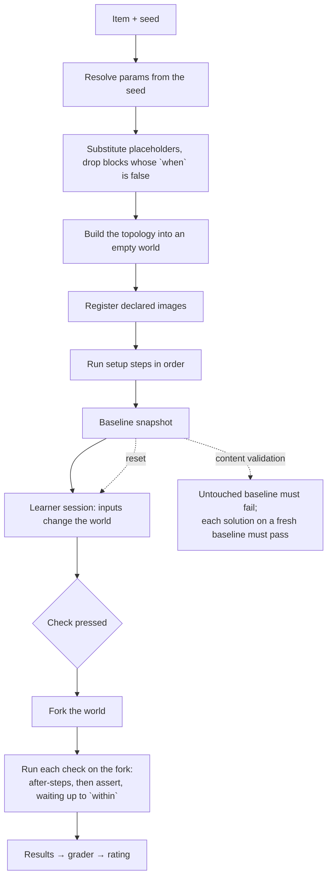

# Scenario format

The schema of a lab-like content item: `lab`, `drill` and `incident`. An item declares a world,
a ticket and how success is recognized; it never scripts a transcript. `PLAN.md` §8 is the model,
this document is the contract for the runner (phase 09), the content tooling (phase 14) and
authors. Lessons, cards and exams reuse these parts and are specified in phase 11.

Machine-readable form: `docs/schema/item.schema.json` and `docs/schema/sidecar.schema.json`
(JSON Schema 2020-12). A test validates the worked examples in §13 against them, so the examples
use only what this document defines.

## 1. Files

```
packages/content/<pack>/
  pack.yaml                      pack id, title, the skills it defines (`id`, `title`); phase 11 adds the rest
  <area>/<id>.yaml               one item per file; the file name is the item id
  <area>/<id>.vi.yaml            optional Vietnamese sidecar (§12)
```

- YAML 1.2, UTF-8, LF line endings. Prose fields are Markdown.
- One item per file. The id is globally unique and never changes once progress refers to it.
- An item is self-contained: everything needed to build its world is in the file, the topology
  it names and the image catalog.

## 2. Anatomy

| Field | Required | Type | Meaning |
|---|---|---|---|
| `id` | yes | dotted lowercase | `<domain>.<area>.<slug>-NN`, equal to the file name |
| `kind` | yes | `lab` \| `drill` \| `incident` | Item type (`PLAN.md` §5) |
| `title` | yes | text | Short, shown in lists. Must not give the answer away |
| `skills` | yes | list of skill ids | What solving it practices. First is the primary skill |
| `curriculum` | yes | list of competency ids | Ids from `docs/curriculum/competencies.yaml` |
| `difficulty` | yes | 1–5 | 1 one step with guidance … 5 several interacting causes |
| `targetMinutes` | yes | number | Time a fluent engineer needs; the rating compares against it |
| `world` | yes | map | Topology, parameters, images, setup (§4, §5) |
| `ticket` | yes | Markdown | The task or symptom, as a real ticket would state it |
| `hints` | yes | list | Ladder from nudge to exact command (§10) |
| `checks` | yes | list | What "solved" means (§7) |
| `solutions` | yes | list | Reference solutions; each must pass every check (§10) |
| `debrief` | yes | Markdown or blocks | Root cause, mental model, solution explained, "in reality" notes |

Unknown fields are errors.

## 3. Life of an item



- The runner is in `learn`. It knows steps, checks, faults and topologies only by name, through
  the kernel registry (`docs/ARCHITECTURE.md` §2.11).
- Setup runs headlessly in virtual time. A setup step that fails, or that triggers a `[sim]`
  notice, makes the item invalid.
- Checks always run on a fork. They cannot disturb the session, and they may change their fork
  freely (advance time, delete a Pod to see whether it comes back).

## 4. Parameters, placeholders and `when`

Parameters make an item a template. A review presents another variant, so the method is
recalled, not the answer.

```yaml
world:
  params:
    ns:       { pick: [shop, billing, media] }
    replicas: { int: { min: 3, max: 5 } }
    fault:    { pick: [stopped, apiserver-port] }
```

| Generator | Value |
|---|---|
| `pick: [a, b, …]` | One element, uniformly. At least two, all different |
| `int: { min, max }` | An integer in the closed range |

- Names match `[a-z][a-zA-Z0-9]*`.
- Resolution is deterministic: parameters are drawn in the order written, from a PRNG stream
  seeded by the item id and the seed. Adding a parameter at the end does not change the others.
- Parameters are independent. When two values must differ, give them disjoint lists.
- Every combination of values must produce a valid item. Content validation samples several seeds
  and, for `pick` parameters used in `when`, covers every value at least once.

**Placeholders.** `{{name}}` in any string under `world.setup`, `world.images`, `ticket`, `hints`,
`checks`, `solutions` and `debrief` is replaced by the parameter's value.

- There are no expressions, filters or defaults. A placeholder naming an undeclared parameter is
  an error.
- A string that is exactly one placeholder takes the parameter's type: `count: "{{replicas}}"`
  becomes the integer. Inside a longer string the value is inserted as text.
- A literal `{{` is written `\{{`.
- YAML reads a value that *starts* with `{` as a flow mapping, so quote it: `namespace: "{{ns}}"`.
  A placeholder in the middle of a plain scalar needs no quotes: `run: kubectl -n {{ns}} get pods`.
- Substitution is textual and happens before embedded YAML (an `apply` body) is parsed.

**`when`.** Steps, checks, hints, named solutions and debrief blocks may carry `when`. The block
exists only for parameter values that match.

```yaml
when: { fault: stopped }                 # equals
when: { fault: [stopped, masked] }       # any of
when: { fault: stopped, node: node01 }   # all keys must match
```

This is how one item holds a family of faults: the parameter picks the fault, `when` selects its
setup, its hints and its part of the debrief.

## 5. World

```yaml
world:
  topology: kubeadm-1cp-2w
  topologyParams: { networkPolicy: enforced }   # optional, defined by the topology
  startTime: 2026-11-13T09:00:00Z               # optional
  entry: { machine: workstation, user: student } # optional
  params: { … }
  images: { … }
  setup: [ … ]
```

### 5.1 Topology

`topology` names a registered topology template. `topologyParams` are validated against the
schema the topology registers. A topology builds a healthy, settled world.

| Topology | Machines | Entry | Parameters |
|---|---|---|---|
| `kubeadm-1cp-2w` (the default) | `controlplane` (kubeadm control plane, tainted), `node01`, `node02` | root on `controlplane` | none yet |
| `kubeadm-1n` | `controlplane`, control plane and worker, untainted | root on `controlplane` | none yet |
| `ubuntu-1` | `node01`, a plain Ubuntu server | `student` on `node01` | none |

`PLAN.md` §7 also plans a student workstation in `kubeadm-1cp-2w`; it is added by the first phase
that can reach it (D-055). What each Kubernetes topology contains: `docs/ARCHITECTURE.md` §4.7.

### 5.2 Entry and start time

- `entry` is where the learner's first terminal opens and the default target of `run` steps. It
  defaults to the topology's entry.
- `startTime` fixes the virtual date at which the world starts, for items where dates matter
  (certificate expiry). Without it, an interactive session starts at the real current time and
  headless runs use a fixed default (`docs/ARCHITECTURE.md` §2.2).

### 5.3 Setup

`setup` is a list of steps (§6) run in order on the topology. It builds the situation the ticket
describes. Prefer steps a real person could have run (`run`, `apply`): the world then contains
the same traces a real incident would (events, last-applied annotations, shell-visible state).
Use a fault injector only for what no command produces.

End a setup with an `until` step rather than a fixed `advance` when a later part depends on the
world having reached a state.

### 5.4 Images

Container images come from the curated catalog (`PLAN.md` §4.3; its format and the images in it are in
`docs/BEHAVIOR_MODELS.md` §5). An item may declare more, as
declarative behavior models. A declared image exists in the simulated registry for this item only.

```yaml
images:
  registry.example.com/shop/api:2.3:
    listen:
      - { port: 8080, protocol: http }
    routes:
      - { path: /healthz, status: 200, body: ok }
    requires:
      - name: database
        connect: { host: { env: DB_HOST }, port: 5432 }
        otherwise: { mode: unhealthy, log: "cannot reach database" }
    startup: { after: 2s, log: ["listening on :8080"] }
```

| Field | Meaning |
|---|---|
| `listen` | Ports the main process listens on once started. `protocol` is `tcp` or `http` |
| `routes` | For `http` listeners: path, status and body. Unlisted paths answer 404 |
| `requires` | Dependencies checked through the network model, at start and whenever reachability changes. `host` and `port` are literals or `{ env: NAME }` read from the container's environment |
| `requires[].otherwise` | `mode: unhealthy`: the process keeps running, every route answers 503 and `log` is written. `mode: exit`: the process writes `log` and exits with `code` after `after` |
| `startup` | Delay before listening and the log lines written at start |
| `exit` | For run-to-completion images: exit code, time and log lines |
| `shell` | Whether `kubectl exec` can start a shell in it (default true) |

A log line declared here is the log of an invented application, not of a real tool, so the
grounding rule does not apply to it. The image reference must not name a real public image.

## 6. Steps

Setup, solutions and a check's `after` are lists of steps. A step is a map with exactly one kind
key, optional modifiers, and optional `when`.

### 6.1 Kinds

| Step | Registered by | Meaning |
|---|---|---|
| `run: <command line>` | host | Type the line into a shell and wait for it to finish |
| `apply: <manifests>` | k8s | Submit the YAML documents to the API server as cluster admin, with `kubectl apply` semantics |
| `write: { path, content, mode?, owner?, group? }` | host | Create or replace a file |
| `fault: <name>` with `with: { … }` | host, domains | Call a fault injector (§8) |
| `advance: <duration>` | the runner | Let virtual time pass |
| `until: { assert, with, not? }` with `timeout: <duration>` | the runner | Let time pass until the check holds; the step fails if it does not within the timeout |

- `advance` and `until` need only the kernel and the check registry, so the runner in `learn`
  implements them and no plugin registers them (D-094).
- `apply` is `kubectl apply -f -` with the documents on standard input, typed into a root shell
  on the machine the API server runs on, with kubeadm's `/etc/kubernetes/admin.conf`. The world
  then holds exactly what a person running that command leaves (the last-applied annotation,
  events), and a wrong manifest fails the step with kubectl's own error.
- `until` and `within` (§7) look at the world now and then once per poll interval: one second,
  or a sixtieth of the timeout when that is longer, so a wait costs at most about sixty
  evaluations (D-095).
- Every step fails when the engine reports a gap while it runs: a `[sim]` notice of a command,
  and also a behavior a model does not cover (an image whose start is not fully captured).
  Content must stay inside what the simulator knows.

Durations are an integer and a unit: `500ms`, `90s`, `5m`, `2h`, `1d`.

### 6.2 `run`

```yaml
- run: systemctl restart kubelet
  on: node01          # machine; default: the entry machine
  as: root            # user; default: the entry user on the entry machine, root elsewhere
  expect: { exit: 0 } # default 0; the step fails on any other status
```

- The line goes through the real simulated shell: aliases, pipes, redirects and quoting behave
  as they do for the learner.
- Within one list of steps, all `run` steps with the same `on` and `as` share one shell session,
  so `cd`, variables and files persist from step to step. A different `on` is a separate login,
  not a nested `ssh`. The logins end (`exit`, then the terminal closes) when the list ends.
- These shells are plain sessions without line editing, separate from the learner's terminal,
  which opens after setup. Nothing a setup types reaches the learner's shell history.
- The step waits until the command returns. A command that would block forever (`kubectl get -w`)
  is an error in a step.
- A step that triggers a `[sim]` notice fails.

### 6.3 Answering the editor

When the command opens an editor (`vim f`, `kubectl edit …`), the step supplies the edit:

```yaml
- run: kubectl -n shop edit deployment web
  editor:
    - replace: { from: "replicas: 1", to: "replicas: 3" }
- run: vim notes.txt
  editor:
    - write: |
        full new content
```

`replace` substitutes the first occurrence and fails if `from` is absent; `write` replaces the
whole buffer. The operations are applied to the content the editor was opened with, the result is
saved and the editor closed (`docs/ARCHITECTURE.md` §3.8). A command that opens an editor without
an `editor` field fails the step.

### 6.4 `write`

`path` is absolute, or relative to the home directory of the user `as`. The file is written
directly, not through a shell, with owner `as` unless `owner` says otherwise. Use it in setup to
place files, and in solutions for what a learner would create in an editor.

## 7. Checks

A check asserts on final state or on observable behavior. It never looks at the commands typed
or at the trace (CLAUDE.md hard rule 6).

```yaml
checks:
  - id: replicas-ready                 # unique in the item, lowercase with dashes
    title: All replicas of `web` are ready   # shown in the debrief; translatable
    assert: k8s.podsReady              # a registered check
    with: { namespace: "{{ns}}", selector: app=web, count: 3 }
    not: false                         # optional: invert
    within: 30s                        # optional: may become true within this virtual time
    after: [ … ]                       # optional: steps run on the fork first
    weight: 2                          # optional: share of the score, default 1
    when: { … }                        # optional
```

Evaluation of one check, on its own fork of the session world:

1. Run the `after` steps, if any. A failing step fails the check with that step's error; a step
   the simulator cannot run (a gap) makes the check an error.
2. Evaluate `assert` with `with`. With `within`, re-evaluate as virtual time advances on the fork
   and pass as soon as it holds; fail at the deadline. Without it, evaluate once, now.
3. Apply `not`.

- Each check gets a fresh fork, so checks are independent and their order does not matter.
- `within` exists because the learner may press "check" while the world is still converging. It
  must be long enough for a correct solution to converge and is not a way to wait for luck.
- A check that cannot be evaluated (it names a machine that does not exist, its command prints a
  `[sim]` notice) is an error, reported as such. It is neither a pass nor a fail.
- The grader passes the item when every check passes. `title` is what the learner sees per
  check, so it states the requirement, not the mechanism.
- Each result says what the check wanted (`expected`, written by the check from its arguments)
  and what it found (`observed`), so a failed check explains itself in the debrief. These texts
  are the simulator's own voice, not imitations of a tool's output.
- **Weights and partial credit.** The score is the weight of the passed checks over the total
  weight. It feeds the rating (phase 11); passing the item still needs every check (D-096).

Checks often encode the ticket's constraints ("do not remove the taint"). Write those as checks
too, with `not` where needed, so that a shortcut that breaks a constraint fails.

### 7.1 Catalog

Checks are registered by plugins under the registry kind `check` with a name, an argument schema
and a function (`docs/ARCHITECTURE.md` §2.11). The catalog below is the one specified in phase 00;
each check is implemented by the phase that builds what it inspects, and more are added the same
way. Argument schemas are in `docs/schema/item.schema.json`.

| Check | Arguments | Passes when | Since |
|---|---|---|---|
| `shell.exec` | `run`, `on?`, `as?`, `exit?` (0), `stdout?`, `stderr?` | The command, run in a new shell on the fork, exits with `exit` and its output satisfies the matchers | 09 |
| `host.file` | `on`, `path`, `exists?` (true), `type?`, `contains?`, `matches?`, `mode?`, `owner?`, `group?` | The file exists (or not) with the given properties | 09 |
| `host.unit` | `on`, `unit`, `active?`, `enabled?` | The systemd unit is in the given states | 25a |
| `net.reach` | `from`, `to`, `expect?` (`answered`), `status?`, `bodyContains?` | A connection from the source to the URL has the expected client-visible outcome | 17 |
| `k8s.object` | `kind`, `apiVersion?`, `namespace?`, `name?` or `selector?`, `exists?`, `count?`/`min?`/`max?`, `where?` | The selected objects exist in the expected number and every `where` clause holds for each | 09 |
| `k8s.podsReady` | `namespace`, `selector`, `count?`/`min?`/`max?` | That many Pods matching the selector have the Ready condition and are not terminating | 09 |
| `k8s.rollout` | `namespace`, `name`, `kind?` (`Deployment`) | The rollout is complete in the sense of `kubectl rollout status` | 09 (Deployment) |
| `k8s.nodeReady` | `node`, `ready?` (true) | The node's Ready condition is `True` (or is not) | 26a |
| `k8s.nodeHasTaint` | `nodes`, `key`, `value?`, `effect?` | Every listed node carries the taint | 09 |
| `k8s.endpoints` | `namespace`, `service`, `count?`/`min?`/`max?` | The Service has that many ready endpoints | 09 |
| `k8s.unchanged` | `kind`, `apiVersion?`, `namespace?`, `name?` or `selector?`, `paths` | The objects selected in the baseline are the ones selected now (same names, same uids), and every path yields the same values as in the baseline | 09 |
| `k8s.notRecreated` | `kind`, `apiVersion?`, `namespace?`, `name` | The object exists with the uid it had in the baseline | 09 |
| `k8s.can` | `as`, `verb`, `resource`, `namespace?`, `name?`, `allowed?` (true) | The authorizer allows (or denies) the request for that identity | 20a |

Details:

- **Matchers** (`stdout`, `stderr`): `equals` (after removing one trailing newline), `contains`,
  `notContains`, `matches` (a JavaScript regular expression; `^` and `$` match at line ends).
  A matcher may hold several keys; all must hold. `shell.exec` runs the command as
  `{ <command>\n} 2><file>` in a plain shell on the fork, so standard output and standard error
  are judged separately.
- **Counting** (`count`, `min`, `max`): with none of them, at least one object (for `k8s.object`
  with `exists: false`, none). `count` excludes `min` and `max`.
- **Selection** (`k8s.object`, `k8s.unchanged`): by `name`, by label `selector`, or every object
  of the kind; a namespaced kind without `namespace` reads `default`, as kubectl does, and a
  `namespace` on a cluster-scoped kind is an error. Terminating objects count. Without
  `apiVersion` the kind maps to the first group version serving it, the core group first.
- **Constraint checks** (`k8s.unchanged`, `k8s.notRecreated`) compare the session world with the
  baseline, the world as setup left it. They are how "do not change the nodes" and "do not
  recreate the Service" become checks.
- Checks read through the API server as `kubernetes-admin` in `system:masters`, so a learner's
  RBAC changes cannot hide an object from them.
- **`net.reach` sources**: `{ machine: <name> }`, or `{ pod: { namespace, selector } }` or
  `{ pod: { namespace, name } }`; with a selector, the first ready Pod in name order. `to` is a
  URL (`http://api.shop.svc.cluster.local:8080/healthz`) or `host:port`. Outcomes are those of the
  network model: `answered`, `refused`, `timeout`, `unresolved`. The `pod` source kind is
  contributed by the Kubernetes plugin; the check itself belongs to the host.
- **`k8s.object` `where`**: `path` is a JSONPath in `kubectl -o jsonpath` syntax
  (`{.spec.replicas}`). Operators: `equals`, `notEquals`, `in`, `contains`, `matches`, `exists`,
  `gte`, `lte`; one per clause. A path that yields several values holds when every value
  satisfies the operator; a path that yields none fails every operator but `exists: false` and
  `notEquals`. Scalars compare by the text jsonpath would print, so `equals: 3` matches `3` and
  `"3"`. Until phase 15 ports client-go's jsonpath, paths are limited to fields (with `\.`
  escapes), `[n]`, `[*]`, `.*` and `['key']`; other syntax makes the check an error.
- **`shell.exec` is the escape hatch.** Prefer a typed check: it gives a better message in the
  debrief and does not depend on output formatting. Use `shell.exec` for behavior only a command
  shows (`kubectl exec … -- printenv NAME`).

## 8. Faults

A fault injector puts the world into a state that a real system could be in but that no simulated
command produces conveniently: a process that died, a certificate that has expired.

```yaml
- fault: host.process.kill
  with: { on: node01, unit: containerd, signal: KILL }
```

- Registered by plugins under the registry kind `fault`, with a name, an argument schema and a
  function that mutates the world (`docs/ARCHITECTURE.md` §2.11).
- **Reachability rule.** The state after a fault must be one the real system can reach, and it
  must be internally consistent: a killed process leaves the unit state systemd would show, not
  just a missing table entry. A fault never plants a symptom (a fake event, a canned error); it
  changes a cause, and the engine produces the symptoms.
- Faults are for setup. Solutions never use them.

Catalog specified in phase 00, implemented with the subsystems they touch:

| Fault | Arguments | Effect |
|---|---|---|
| `host.process.kill` | `on`, `unit`, `signal?` (`KILL`) | The unit's main process receives the signal; systemd reacts according to the unit's restart policy |
| `k8s.cert.setValidity` | `on`, `path`, `notAfter` (relative to now, e.g. `-1h`) | The certificate at `path` is reissued by its CA with the given end of validity |

## 9. Registration and the schema

Plugins contribute steps, checks, faults and topologies to the registry; `learn` resolves the
names an item uses. `item.schema.json` is generated: `npm run content:schema` writes the item
layout (`packages/learn/src/item/schema.base.ts`) with `$defs.step`, `$defs.assertion` and the
topology names taken from the registry, so the schema cannot drift from the code; a test fails
when the file is stale.

- The raw item, before substitution, is validated against it, so a typed argument (an integer,
  a boolean, an enum, a patterned string) also accepts a placeholder there. After substitution,
  every argument map of every variant is validated again against the registered schema itself.
- The engine validates with its own JSON Schema validator for the subset these schemas use
  (`packages/learn/src/item/jsonschema.ts`, D-093); a test checks that it agrees with Ajv.
- The worked examples in §13 use checks of later phases; their test adds stand-ins with the
  phase 00 argument schemas (`tools/src/docs/planned.ts`), which each phase replaces with the
  real check.

An item that uses a name the registry does not have is invalid. There is no fallback and no
"unknown check passes".

## 10. Ticket, hints, solutions, debrief

**Ticket.** A goal with constraints (lab, drill) or a symptom (incident), written as the person
who has the problem would write it. It never names the command or the resource to edit. State
the constraints the checks enforce.

**Hints** are a ladder; each costs rating:

1. A nudge: where to look.
2. A direction: what to compare or which mechanism is involved.
3. The exact command or change.

A hint is a string, or `{ text, when }` for a hint that applies to one fault variant. Labs and
incidents have at least three levels for every variant; drills at least one.

**Solutions.** Each solution is a list of steps, or `{ name, steps, when? }`. Every solution is
executed headlessly on a fresh baseline and must then pass every check, for every sampled seed.
Give more than one when the task has clearly different valid paths (imperative and declarative;
fix the label or fix the selector): they prove that the checks grade state and not a path.
End a solution with an `until` step for what the world must converge to.

**Debrief.** Markdown, or a list of `{ text, when? }` blocks concatenated in order. It contains:
the root cause in one or two sentences; the mental model that makes the cause findable next time;
the reference solution explained; "in reality" notes where a real cluster or distribution differs
or where the simulator diverges (link `docs/FIDELITY.md` register entries by id). Quoted real
output in a debrief follows the grounding rule like any other output.

## 11. Validation

`npm run content:check` enforces, for every item and several seeds (1 to 5, then more until
every `pick` value a `when` depends on has appeared; `--seeds N` changes the 5):

1. The file parses and satisfies `item.schema.json`; the id equals the file name; ids are unique.
2. Skills exist in a pack; curriculum ids exist in `docs/curriculum/competencies.yaml`.
3. Every placeholder names a declared parameter; every `when` key is a `pick` parameter and
   every value is one of its options.
4. Setup completes with no failed step and no `[sim]` notice.
5. On the untouched baseline, the item **fails**: at least one check fails, and no check errors.
6. Each solution, on a fresh baseline, completes and then **every** check passes.
7. For every variant: at least one solution applies, at least one check applies, the hint
   ladder is complete, and every argument map satisfies its registered schema.
8. Check ids are unique; every check has a title; every parameter is used; solutions inject no
   faults; topology parameters satisfy the topology's schema.

Rules 5 and 6 are CLAUDE.md hard rule 6. A check that passes on the untouched world and exists
only to guard a constraint is fine, as long as some other check fails.

## 12. Vietnamese sidecar

English in the item file is canonical. Vietnamese lives next to it in `<id>.vi.yaml`, one entry
per text unit, each with the hash of the English text it was translated from.

```yaml
id: k8s.workloads.configmap-env-rollout-01
lang: vi
units:
  title:
    source: sha256:0123456789abcdef
    text: …
  hints.0:
    source: sha256:…
    text: …
```

**Text units** and their keys:

| Key | Unit |
|---|---|
| `title` | The item title |
| `ticket` | The ticket |
| `hints.<n>` | Hint at index `n` (zero-based) |
| `checks.<id>.title` | Title of the check with that id |
| `debrief` | The debrief when it is one string |
| `debrief.<n>` | Debrief block at index `n` |
| `solutions.<n>.name` | Name of the named solution at index `n` |

**Source hash.** `sha256:` followed by the first 16 hexadecimal digits of the SHA-256 of the
English unit, taken before placeholder substitution and after normalization: CRLF to LF, trailing
whitespace removed from each line, leading and trailing blank lines removed.

**States of a unit**, computed when content is built:

| State | Condition | The app shows |
|---|---|---|
| current | The sidecar has the unit and its hash equals the hash of the English text | Vietnamese |
| outdated | The hash differs | English, with a badge; Vietnamese available on request |
| missing | No entry | English, with a badge |

- A missing or outdated translation never blocks anything and never fails the gate.
  `npm run content:i18n` (phase 11) reports them.
- The translation uses the same placeholders as the source.
- Resource names, commands, flags, paths and code stay in English. Mechanically: every code span
  and code block of the source appears unchanged in the translation. The report flags violations.
- Terminal output, check results computed by the engine and `[sim]` notices are never translated.
- Hints are addressed by index. Reordering hints changes hashes at those indexes, which marks the
  affected units outdated; that is the intended behavior.
- An entry whose key matches no unit of the item is reported as orphaned.

## 13. Worked examples

Three complete items. They are written to run: the features they need arrive in the phases
named in each introduction, and the items then move to `packages/content/`.

### 13.1 CKAD workload task

A configuration and rollout task. It shows integer and string parameters, typed placeholders, two
solutions on different paths, a `where` clause that accepts two spellings of the same setting, and
a behavioral check: instead of inspecting how the environment variable is wired, the check changes
the ConfigMap on its fork, restarts the rollout and looks at what the container sees. A literal
copy of the value passes inspection of the current state but fails this. Needs phases 08, 16a
and 17.

```yaml item
id: k8s.workloads.configmap-env-rollout-01
kind: lab
title: Move a setting into a ConfigMap and roll it out safely
skills:
  - k8s.config.configmap-env
  - k8s.workloads.rolling-update-strategy
  - k8s.workloads.scale
curriculum:
  - ckad.config.configmaps
  - ckad.deployment.rolling-updates
  - cka.workloads.configmaps-secrets
difficulty: 2
targetMinutes: 6
world:
  topology: kubeadm-1cp-2w
  params:
    ns: { pick: [payments, catalog, search] }
    level: { pick: [debug, warn, error] }
    otherLevel: { pick: [trace, info, fatal] }
    replicas: { int: { min: 3, max: 5 } }
  setup:
    - apply: |
        apiVersion: v1
        kind: Namespace
        metadata:
          name: {{ns}}
        ---
        apiVersion: apps/v1
        kind: Deployment
        metadata:
          name: api
          namespace: {{ns}}
        spec:
          replicas: 2
          selector:
            matchLabels:
              app: api
          template:
            metadata:
              labels:
                app: api
            spec:
              containers:
                - name: api
                  image: nginx:1.27
                  ports:
                    - containerPort: 80
    - until:
        assert: k8s.rollout
        with: { namespace: "{{ns}}", name: api }
      timeout: 3m
ticket: |
  The `api` Deployment in namespace `{{ns}}` still runs with the log level baked into its image.
  The team wants the setting in configuration:

  - A ConfigMap named `api-config` holds the key `LOG_LEVEL` with the value `{{level}}`.
  - The `api` container receives it as the environment variable `LOG_LEVEL`. Changing the
    ConfigMap and restarting the rollout must be enough to change the value the container sees.
  - The Deployment runs {{replicas}} replicas.
  - During a rollout, no Pod may be taken down before its replacement is ready.
hints:
  - Three separate changes are asked for. Which object does each one belong to?
  - >-
    An environment variable can take its value from a key of a ConfigMap instead of a literal.
    How many Pods may be missing during a rollout is part of the Deployment's update strategy.
  - >-
    `kubectl create configmap api-config --from-literal=LOG_LEVEL={{level}}`, then
    `kubectl set env deployment/api --from=configmap/api-config`, `kubectl scale`, and set
    `spec.strategy.rollingUpdate.maxUnavailable` to `0`. All in namespace `{{ns}}`.
checks:
  - id: configmap-value
    title: ConfigMap `api-config` holds `LOG_LEVEL={{level}}`
    assert: k8s.object
    with:
      kind: ConfigMap
      namespace: "{{ns}}"
      name: api-config
      where:
        - { path: "{.data.LOG_LEVEL}", equals: "{{level}}" }
  - id: container-sees-value
    title: The `api` container sees `LOG_LEVEL={{level}}`
    assert: shell.exec
    with:
      run: kubectl -n {{ns}} exec deploy/api -c api -- printenv LOG_LEVEL
      stdout: { equals: "{{level}}" }
    within: 2m
  - id: value-follows-configmap
    title: Changing the ConfigMap and restarting the rollout changes what the container sees
    after:
      - run: kubectl -n {{ns}} patch configmap api-config --type merge -p '{"data":{"LOG_LEVEL":"{{otherLevel}}"}}'
      - run: kubectl -n {{ns}} rollout restart deployment api
      - until:
          assert: k8s.rollout
          with: { namespace: "{{ns}}", name: api }
        timeout: 5m
    assert: shell.exec
    with:
      run: kubectl -n {{ns}} exec deploy/api -c api -- printenv LOG_LEVEL
      stdout: { equals: "{{otherLevel}}" }
  - id: replicas-ready
    title: "{{replicas}} replicas of `api` are ready"
    assert: k8s.podsReady
    with: { namespace: "{{ns}}", selector: app=api, count: "{{replicas}}" }
    within: 2m
  - id: no-pod-down-early
    title: A rollout never takes a Pod down before its replacement is ready
    assert: k8s.object
    with:
      kind: Deployment
      namespace: "{{ns}}"
      name: api
      where:
        - { path: "{.spec.strategy.type}", equals: RollingUpdate }
        - { path: "{.spec.strategy.rollingUpdate.maxUnavailable}", in: [0, "0%"] }
solutions:
  - name: Imperative commands
    steps:
      - run: kubectl -n {{ns}} create configmap api-config --from-literal=LOG_LEVEL={{level}}
      - run: kubectl -n {{ns}} set env deployment/api --from=configmap/api-config
      - run: kubectl -n {{ns}} scale deployment api --replicas={{replicas}}
      - run: kubectl -n {{ns}} patch deployment api -p '{"spec":{"strategy":{"rollingUpdate":{"maxUnavailable":0}}}}'
      - until:
          assert: k8s.rollout
          with: { namespace: "{{ns}}", name: api }
        timeout: 5m
  - name: One manifest, applied
    steps:
      - write:
          path: api.yaml
          content: |
            apiVersion: v1
            kind: ConfigMap
            metadata:
              name: api-config
              namespace: {{ns}}
            data:
              LOG_LEVEL: {{level}}
            ---
            apiVersion: apps/v1
            kind: Deployment
            metadata:
              name: api
              namespace: {{ns}}
            spec:
              replicas: {{replicas}}
              strategy:
                type: RollingUpdate
                rollingUpdate:
                  maxSurge: 1
                  maxUnavailable: 0
              selector:
                matchLabels:
                  app: api
              template:
                metadata:
                  labels:
                    app: api
                spec:
                  containers:
                    - name: api
                      image: nginx:1.27
                      ports:
                        - containerPort: 80
                      envFrom:
                        - configMapRef:
                            name: api-config
      - run: kubectl apply -f api.yaml
      - until:
          assert: k8s.rollout
          with: { namespace: "{{ns}}", name: api }
        timeout: 5m
debrief: |
  **What was asked.** Three independent changes: a ConfigMap, a reference to it from the Pod
  template, and two fields of the Deployment (`replicas` and the rolling update strategy).

  **Mental model.** A container's environment is fixed when the container starts. A ConfigMap
  reference (`valueFrom.configMapKeyRef` for one key, `envFrom.configMapRef` for all keys) is
  resolved by the kubelet at that moment. So the value follows the ConfigMap only across a
  restart: changing the ConfigMap changes nothing in running Pods, and `kubectl rollout restart`
  is what makes new Pods pick it up. Copying the value into `env.value` works today and breaks
  this property, which is why the task is graded by changing the ConfigMap and looking again.

  **Rollout safety.** `maxUnavailable` and `maxSurge` both default to 25%
  (upstream: `pkg/apis/apps/v1/defaults.go`). The surge is rounded up and the unavailable count is
  rounded down (upstream: `pkg/controller/deployment/util/deployment_util.go` `ResolveFenceposts`).
  Setting `maxUnavailable: 0` states the requirement explicitly instead of relying on rounding,
  and it requires `maxSurge` to be greater than zero.

  **Reference solution.** `kubectl create configmap … --from-literal`, `kubectl set env
  --from=configmap/api-config` (it adds one `configMapKeyRef` entry per key), `kubectl scale`, and
  a patch of `spec.strategy.rollingUpdate.maxUnavailable`. Writing the manifest and applying it
  is equally valid and is what you would commit to Git.

  **In reality.** A ConfigMap mounted as a volume is different: the kubelet refreshes the files
  in running Pods after a delay, with no restart. Only environment variables and `subPath` mounts
  are frozen at start.
```

Its Vietnamese sidecar, `k8s.workloads.configmap-env-rollout-01.vi.yaml`. Not every unit is
translated: the rest show English with a badge.

```yaml sidecar
id: k8s.workloads.configmap-env-rollout-01
lang: vi
units:
  title:
    source: sha256:b55822000e01327e
    text: Đưa một thiết lập vào ConfigMap và rollout an toàn
  ticket:
    source: sha256:89d1994851354915
    text: |
      Deployment `api` trong namespace `{{ns}}` vẫn đang chạy với log level được đóng cứng trong
      image. Team muốn đưa thiết lập này ra cấu hình:

      - Một ConfigMap tên `api-config` chứa key `LOG_LEVEL` với giá trị `{{level}}`.
      - Container `api` nhận giá trị đó qua biến môi trường `LOG_LEVEL`. Chỉ cần sửa ConfigMap
        rồi restart rollout là giá trị container nhìn thấy phải thay đổi theo.
      - Deployment chạy {{replicas}} replica.
      - Trong lúc rollout, không Pod nào được phép bị tắt trước khi Pod thay thế nó sẵn sàng.
  hints.0:
    source: sha256:aca00f5cabe998e2
    text: Đề bài yêu cầu ba thay đổi riêng biệt. Mỗi thay đổi thuộc về object nào?
  checks.configmap-value.title:
    source: sha256:be67963d647c396a
    text: ConfigMap `api-config` chứa `LOG_LEVEL={{level}}`
  checks.replicas-ready.title:
    source: sha256:9d4dde219f3356b2
    text: "{{replicas}} replica của `api` đã sẵn sàng"
```

### 13.2 CKA node troubleshooting

A node is NotReady for one of three reasons, chosen by a parameter. It shows a fault family with
`when` on setup steps, hints, checks, solutions and debrief blocks; steps on another machine as
root; an `until` step that waits for the symptom instead of guessing a duration; `within` on
checks; and a solution that answers the editor. Every fault is produced by commands an
administrator could have run, so no fault injector is needed. Needs phases 22a, 25a, 26a and 26b.

```yaml item
id: k8s.nodes.notready-kubelet-01
kind: lab
title: A worker node went NotReady
skills:
  - k8s.troubleshooting.node-notready
  - k8s.nodes.kubelet-service
  - linux.systemd.units
curriculum:
  - cka.troubleshooting.clusters-nodes
  - cka.troubleshooting.cluster-components
difficulty: 3
targetMinutes: 8
world:
  topology: kubeadm-1cp-2w
  params:
    node: { pick: [node01, node02] }
    fault: { pick: [kubelet-stopped, apiserver-port, runtime-stopped] }
  setup:
    - apply: |
        apiVersion: apps/v1
        kind: Deployment
        metadata:
          name: reports
          namespace: default
        spec:
          replicas: 2
          selector:
            matchLabels:
              app: reports
          template:
            metadata:
              labels:
                app: reports
            spec:
              nodeSelector:
                kubernetes.io/hostname: {{node}}
              containers:
                - name: reports
                  image: nginx:1.27
    - until:
        assert: k8s.podsReady
        with: { namespace: default, selector: app=reports, count: 2 }
      timeout: 3m
    - run: systemctl disable --now kubelet
      on: "{{node}}"
      as: root
      when: { fault: kubelet-stopped }
    - run: sed -i 's/:6443/:6444/' /etc/kubernetes/kubelet.conf
      on: "{{node}}"
      as: root
      when: { fault: apiserver-port }
    - run: systemctl restart kubelet
      on: "{{node}}"
      as: root
      when: { fault: apiserver-port }
    - run: systemctl disable --now containerd
      on: "{{node}}"
      as: root
      when: { fault: runtime-stopped }
    - until:
        assert: k8s.nodeReady
        with: { node: "{{node}}", ready: false }
      timeout: 10m
ticket: |
  Monitoring reports that `{{node}}` is NotReady, and the `reports` application in the `default`
  namespace, which runs only on that node, is no longer ready.

  Bring the node back so that it stays healthy after a reboot. You can reach the nodes with
  `ssh <node>` and become root with `sudo -i`.
hints:
  - A node reports its own status. Which component on the node does that, and is it able to do its job?
  - text: >-
      On the node, look at the state of the kubelet service, not only whether it is running now
      but also whether it would start at boot.
    when: { fault: kubelet-stopped }
  - text: >-
      The kubelet is running. Read its recent log: who is it trying to talk to, and at which
      address? Compare with where the API server really listens.
    when: { fault: apiserver-port }
  - text: >-
      The kubelet is running and can reach the API server. Read its recent log: what does it
      depend on, on the same node, to run containers?
    when: { fault: runtime-stopped }
  - text: "On `{{node}}` as root: `systemctl enable --now kubelet`."
    when: { fault: kubelet-stopped }
  - text: >-
      On `{{node}}` as root: fix the port in the `server:` line of `/etc/kubernetes/kubelet.conf`
      (the API server listens on 6443), then `systemctl restart kubelet`.
    when: { fault: apiserver-port }
  - text: "On `{{node}}` as root: `systemctl enable --now containerd`."
    when: { fault: runtime-stopped }
checks:
  - id: node-ready
    title: "`{{node}}` is Ready"
    assert: k8s.nodeReady
    with: { node: "{{node}}" }
    within: 2m
  - id: kubelet-survives-reboot
    title: The kubelet on `{{node}}` is running and enabled at boot
    assert: host.unit
    with: { on: "{{node}}", unit: kubelet.service, active: true, enabled: true }
  - id: runtime-survives-reboot
    title: The container runtime on `{{node}}` is running and enabled at boot
    assert: host.unit
    with: { on: "{{node}}", unit: containerd.service, active: true, enabled: true }
  - id: workload-ready
    title: Both `reports` Pods are ready again
    assert: k8s.podsReady
    with: { namespace: default, selector: app=reports, count: 2 }
    within: 3m
solutions:
  - name: Start and enable the kubelet
    when: { fault: kubelet-stopped }
    steps:
      - run: systemctl enable --now kubelet
        on: "{{node}}"
        as: root
      - until:
          assert: k8s.nodeReady
          with: { node: "{{node}}" }
        timeout: 5m
  - name: Correct the API server address in the kubelet's kubeconfig
    when: { fault: apiserver-port }
    steps:
      - run: vim /etc/kubernetes/kubelet.conf
        on: "{{node}}"
        as: root
        editor:
          - replace: { from: ":6444", to: ":6443" }
      - run: systemctl restart kubelet
        on: "{{node}}"
        as: root
      - until:
          assert: k8s.nodeReady
          with: { node: "{{node}}" }
        timeout: 5m
  - name: Start and enable the container runtime
    when: { fault: runtime-stopped }
    steps:
      - run: systemctl enable --now containerd
        on: "{{node}}"
        as: root
      - until:
          assert: k8s.nodeReady
          with: { node: "{{node}}" }
        timeout: 5m
debrief:
  - text: |
      **Mental model.** Nobody watches a node from outside. The kubelet on the node reports the
      node's status to the API server and renews a Lease. When the reports stop, the node
      lifecycle controller in the controller manager sets the node's conditions to `Unknown`,
      which `kubectl get nodes` shows as NotReady. When the kubelet does report but cannot run
      containers, it reports Ready as `False` itself, with the reason in the condition message.

      So a NotReady node always leads to one question, asked on the node: is the kubelet running,
      can it reach the API server, and does it have a working container runtime? `systemctl
      status kubelet` answers the first, `journalctl -u kubelet` the other two.
      `kubectl describe node` tells you which case you are in before you log in: conditions that
      are `Unknown` mean the kubelet is silent; a Ready condition that is `False` carries the
      kubelet's own explanation.
  - when: { fault: kubelet-stopped }
    text: |
      **Root cause.** The kubelet service on `{{node}}` was stopped and disabled.
      `systemctl start kubelet` would have brought the node back, and the next reboot would have
      taken it down again. `systemctl enable --now kubelet` fixes both, and the task checked both.
  - when: { fault: apiserver-port }
    text: |
      **Root cause.** `/etc/kubernetes/kubelet.conf`, the kubeconfig the kubelet uses to talk to
      the API server, pointed at port 6444. The kubelet was running and healthy as a process; it
      just had nobody to report to. The kubelet reads this file at start, so the fix needs a
      restart of the service.
  - when: { fault: runtime-stopped }
    text: |
      **Root cause.** containerd on `{{node}}` was stopped and disabled. The kubelet kept
      running and kept reporting, and what it reported was that the container runtime is down.
      Here the node's Ready condition is `False`, not `Unknown`: the difference tells you the
      kubelet is alive.
  - text: |
      **In reality.** Pods on a NotReady node are not rescheduled at once. They carry a
      toleration for the not-ready taint that lasts 300 seconds by default (upstream:
      `plugin/pkg/admission/defaulttolerationseconds/admission.go`); only after that are they
      evicted and replaced. `reports` is pinned to this node by a node selector, so its
      replacements would stay Pending until the node returns.
```

### 13.3 Chained real-world incident

A vague symptom with three faults that hide one another. Fixing the Service selector reveals the
NetworkPolicy drop; fixing that restores traffic through the old Pods while the rollout stays
stuck on a bad setting. It shows a declared image with a dependency, a topology parameter, setup
that first builds a healthy system and then breaks it with ordinary commands, checks on behavior
through the network model, a constraint written as a check with `expect: timeout`, and two
solutions that fix the policy mismatch from opposite sides. Needs phases 16b, 17, 19a.

```yaml item
id: k8s.incident.checkout-api-unreachable-01
kind: incident
title: Checkout fails after last night's changes
skills:
  - k8s.troubleshooting.service-endpoints
  - k8s.networking.networkpolicy
  - k8s.troubleshooting.stuck-rollout
  - k8s.config.configmap-env
curriculum:
  - cka.troubleshooting.services-networking
  - cka.networking.network-policies
  - ckad.networking.services
  - ckad.networking.network-policies
  - ckad.observability.debugging
difficulty: 4
targetMinutes: 20
world:
  topology: kubeadm-1cp-2w
  topologyParams: { networkPolicy: enforced }
  params:
    ns: { pick: [shop, store, market] }
    wrongApp: { pick: [api-v2, backend, api-server] }
    wrongHost: { pick: [database, postgres, db-primary] }
  images:
    registry.example.com/shop/api:2.3:
      listen:
        - { port: 8080, protocol: http }
      routes:
        - { path: /healthz, status: 200, body: ok }
        - { path: /checkout, status: 200, body: '{"status":"accepted"}' }
      requires:
        - name: database
          connect: { host: { env: DB_HOST }, port: 5432 }
          otherwise: { mode: unhealthy, log: "database connection failed" }
      startup: { after: 2s, log: ["api listening on :8080"] }
    registry.example.com/shop/db:1.0:
      listen:
        - { port: 5432, protocol: tcp }
      startup: { after: 3s, log: ["database ready"] }
  setup:
    - apply: |
        apiVersion: v1
        kind: Namespace
        metadata:
          name: {{ns}}
        ---
        apiVersion: apps/v1
        kind: Deployment
        metadata:
          name: db
          namespace: {{ns}}
        spec:
          replicas: 1
          selector:
            matchLabels:
              app: db
          template:
            metadata:
              labels:
                app: db
            spec:
              containers:
                - name: db
                  image: registry.example.com/shop/db:1.0
                  ports:
                    - containerPort: 5432
        ---
        apiVersion: v1
        kind: Service
        metadata:
          name: db
          namespace: {{ns}}
        spec:
          selector:
            app: db
          ports:
            - port: 5432
              targetPort: 5432
        ---
        apiVersion: v1
        kind: ConfigMap
        metadata:
          name: api-config
          namespace: {{ns}}
        data:
          DB_HOST: db
        ---
        apiVersion: apps/v1
        kind: Deployment
        metadata:
          name: api
          namespace: {{ns}}
        spec:
          replicas: 2
          selector:
            matchLabels:
              app: api
          template:
            metadata:
              labels:
                app: api
            spec:
              containers:
                - name: api
                  image: registry.example.com/shop/api:2.3
                  ports:
                    - containerPort: 8080
                  envFrom:
                    - configMapRef:
                        name: api-config
                  readinessProbe:
                    httpGet:
                      path: /healthz
                      port: 8080
                    periodSeconds: 5
        ---
        apiVersion: v1
        kind: Service
        metadata:
          name: api
          namespace: {{ns}}
        spec:
          selector:
            app: api
          ports:
            - port: 8080
              targetPort: 8080
        ---
        apiVersion: apps/v1
        kind: Deployment
        metadata:
          name: frontend
          namespace: {{ns}}
        spec:
          replicas: 2
          selector:
            matchLabels:
              app: frontend
          template:
            metadata:
              labels:
                app: frontend
                role: frontend
            spec:
              containers:
                - name: frontend
                  image: nginx:1.27
        ---
        apiVersion: apps/v1
        kind: Deployment
        metadata:
          name: reports
          namespace: {{ns}}
        spec:
          replicas: 1
          selector:
            matchLabels:
              app: reports
          template:
            metadata:
              labels:
                app: reports
            spec:
              containers:
                - name: reports
                  image: nginx:1.27
        ---
        apiVersion: networking.k8s.io/v1
        kind: NetworkPolicy
        metadata:
          name: api-allow-frontend
          namespace: {{ns}}
        spec:
          podSelector:
            matchLabels:
              app: api
          policyTypes:
            - Ingress
          ingress:
            - from:
                - podSelector:
                    matchLabels:
                      role: frontend
              ports:
                - protocol: TCP
                  port: 8080
    - until:
        assert: net.reach
        with:
          from: { pod: { namespace: "{{ns}}", selector: app=frontend } }
          to: http://api.{{ns}}.svc.cluster.local:8080/healthz
          status: 200
      timeout: 5m
    - run: kubectl -n {{ns}} patch configmap api-config --type merge -p '{"data":{"DB_HOST":"{{wrongHost}}"}}'
    - run: kubectl -n {{ns}} rollout restart deployment api
    - run: kubectl -n {{ns}} patch service api -p '{"spec":{"selector":{"app":"{{wrongApp}}"}}}'
    - run: kubectl -n {{ns}} patch deployment frontend --type=json -p '[{"op":"remove","path":"/spec/template/metadata/labels/role"}]'
    - until:
        assert: k8s.rollout
        with: { namespace: "{{ns}}", name: frontend }
      timeout: 5m
    - advance: 10m
ticket: |
  **Checkout is failing** (namespace `{{ns}}`)

  Since this morning every checkout in the web shop fails. The `frontend` Pods cannot get an
  answer from `http://api:8080`. The deployment pipeline also reports that last night's rollout
  of `api` never finished.

  Several people changed things in this namespace yesterday evening. Get checkout working again
  and get the `api` rollout to complete.

  The security team requires that `api` stays reachable only from the frontend: do not delete or
  open up the NetworkPolicy.
hints:
  - >-
    Follow one request from a `frontend` Pod to an `api` Pod and test each hop on its own: name
    resolution, the Service, the Pods behind it, and anything that filters traffic in between.
    Expect more than one thing to be wrong; retest after every fix.
  - >-
    Compare what the `api` Service selects with the labels the `api` Pods carry, and what the
    NetworkPolicy allows with the labels the `frontend` Pods carry. For the rollout, look at
    why the newest `api` Pod is not ready and what its log says it cannot reach.
  - >-
    `kubectl -n {{ns}} get endpointslices` shows the Service has no endpoints: set its selector
    back to `app: api`. The policy admits Pods labelled `role: frontend`, which the frontend Pods
    lost: restore the label in the Deployment's Pod template. `DB_HOST` in ConfigMap `api-config`
    names a Service that does not exist: set it to `db` and run
    `kubectl -n {{ns}} rollout restart deployment api`.
checks:
  - id: frontend-reaches-api
    title: A `frontend` Pod gets an answer from the `api` Service
    assert: net.reach
    with:
      from: { pod: { namespace: "{{ns}}", selector: app=frontend } }
      to: http://api.{{ns}}.svc.cluster.local:8080/checkout
      status: 200
    within: 1m
  - id: api-rollout-complete
    title: The rollout of `api` has completed
    assert: k8s.rollout
    with: { namespace: "{{ns}}", name: api }
    within: 3m
  - id: api-serves-from-all-replicas
    title: The `api` Service has both replicas behind it
    assert: k8s.endpoints
    with: { namespace: "{{ns}}", service: api, count: 2 }
    within: 3m
  - id: api-still-restricted
    title: Pods other than the frontend still cannot reach `api`
    assert: net.reach
    with:
      from: { pod: { namespace: "{{ns}}", selector: app=reports } }
      to: http://api.{{ns}}.svc.cluster.local:8080/healthz
      expect: timeout
  - id: policy-kept
    title: The NetworkPolicy `api-allow-frontend` still exists
    assert: k8s.object
    with: { kind: NetworkPolicy, namespace: "{{ns}}", name: api-allow-frontend }
solutions:
  - name: Restore the frontend label
    steps:
      - run: kubectl -n {{ns}} patch service api -p '{"spec":{"selector":{"app":"api"}}}'
      - run: kubectl -n {{ns}} patch deployment frontend -p '{"spec":{"template":{"metadata":{"labels":{"role":"frontend"}}}}}'
      - run: kubectl -n {{ns}} patch configmap api-config --type merge -p '{"data":{"DB_HOST":"db"}}'
      - run: kubectl -n {{ns}} rollout restart deployment api
      - until:
          assert: k8s.rollout
          with: { namespace: "{{ns}}", name: api }
        timeout: 5m
      - until:
          assert: k8s.rollout
          with: { namespace: "{{ns}}", name: frontend }
        timeout: 5m
  - name: Make the policy select the label the frontend has
    steps:
      - run: kubectl -n {{ns}} patch configmap api-config --type merge -p '{"data":{"DB_HOST":"db"}}'
      - run: kubectl -n {{ns}} rollout restart deployment api
      - run: kubectl -n {{ns}} patch networkpolicy api-allow-frontend --type=json -p '[{"op":"replace","path":"/spec/ingress/0/from/0/podSelector/matchLabels","value":{"app":"frontend"}}]'
      - run: kubectl -n {{ns}} patch service api -p '{"spec":{"selector":{"app":"api"}}}'
      - until:
          assert: k8s.rollout
          with: { namespace: "{{ns}}", name: api }
        timeout: 5m
debrief: |
  **Root causes.** Three independent changes, each harmless-looking:

  1. The `api` Service selected `app: {{wrongApp}}`. No Pod has that label, so the Service had
     no endpoints.
  2. The `frontend` Pod template lost its `role: frontend` label. The NetworkPolicy
     `api-allow-frontend` admits only Pods with that label, so frontend traffic to `api` was
     dropped.
  3. ConfigMap `api-config` set `DB_HOST` to `{{wrongHost}}`, a name that resolves to nothing.
     Pods of the new ReplicaSet could not reach the database, failed their readiness probe, and
     the rollout waited for them indefinitely.

  **Why they hid one another.** A request passes the Service first, then the policy. With no
  endpoints the connection fails at the Service, and nothing tells you a policy would have
  dropped it next. And the third fault caused no outage at all: a rolling update keeps the old
  Pods until new ones are ready, so the old ReplicaSet kept serving with the old, correct
  configuration. It would have become an outage at the next node drain.

  **Mental model.** Labels are the wiring. A Service finds Pods by label; a NetworkPolicy
  selects the Pods it protects by label and the peers it admits by label; a Deployment owns Pods
  by label. None of these references is checked when you write it: a selector that matches
  nothing is valid. So for every hop ask "what does this select, and does anything carry that
  label right now?" `kubectl get endpointslices`, `kubectl get pods --show-labels` and
  `kubectl describe networkpolicy` answer it.

  The two failures also look different from the client, and that is the fastest way to tell
  them apart: a Service without endpoints refuses the connection at once, while a policy drop
  lets the client wait until it times out.

  **Method.** Test hop by hop and retest after each fix. When a symptom changes from "refused"
  to "timeout", you fixed something and found the next layer; that is progress, not a failed fix.

  **The stuck rollout.** `kubectl rollout status` waits, `kubectl get pods` shows a new Pod that
  is running and never ready, and its log names what it cannot reach. The variable came from a
  ConfigMap through `envFrom`, so the fix is in the ConfigMap, followed by a rollout restart:
  environment variables are read when a container starts.

  **Either fix for the policy is valid.** Restoring the label keeps the policy as security wrote
  it. Changing the policy to select `app: frontend` is equally correct here; in a real team it
  is the change that needs a review. What is not acceptable, and what the checks reject, is
  deleting the policy or admitting everything.

  **In reality.** Whether a NetworkPolicy has any effect depends on the network plugin; with a
  plugin that does not implement policies, the object is accepted and ignored. This cluster's
  plugin enforces them. And real incidents rarely announce how many causes they have: the
  ticket's "several people changed things" was the hint to keep testing after the first fix.
```

## 14. Not covered yet

| Topic | Phase |
|---|---|
| Figures: `figure` blocks in the ticket, in debrief blocks and in lesson steps (`view`, `compare`, `scene`, `diagram`; `PLAN.md` §6.5 and §8), their validation and their text units | 10c |
| `lesson`, `card` and `exam` items; prediction prompts; the rest of `pack.yaml` (tracks, skill descriptions) | 11 |
| Authoring style guide and content tooling | 14 |
| Topology parameters (none exist yet; the templates are in §5.1) | the first phase whose content needs a variant |
| Declared images (§5.4): the runner refuses `world.images` until then. Behavior model fields beyond §5.4 (the catalog format is decided: `docs/BEHAVIOR_MODELS.md` §5) | the first item that declares an image (16b or 17) |
| Exam task weights and per-domain scoring | 31 |
